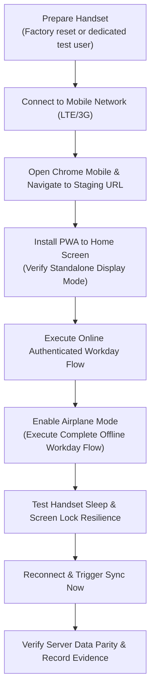

# Carbon Field Sales Tracker — Stage 3F Implementation Specification: End-to-End QA, Physical Device Protocols & Staging Deployment

**Document type:** Technical Implementation & Testing Specification  
**Project:** Carbon Field Sales Tracker  
**Milestone:** Stage 3F — End-to-End QA, Physical Device Testing & Field Pilot Readiness  
**Target Staging URL:** `https://field-sales-tracker-b6l7.vercel.app/`  
**GitHub Repository:** `heebrahymn/field-sales-tracker` (Commit: `d4dbb37`, Tag: `stage-3e-management-approved`)  
**Backend:** Supabase Dev Project `[SUPABASE_PROJECT_ID]` (Migrations 00001–00028 applied)  
**Markets:** Nigeria (`NG`), Zambia (`ZM`), Malawi (`MW`)  
**Status:** Staging Deployed & Automated Verification Complete; Physical Handset Protocol Prepared

---

## 1. Executive Summary & Objective

Stage 3F transitions the Carbon Field Sales Tracker from feature development (Stages 3A–3E) to end-to-end quality assurance, live staging verification, and field-pilot deployment readiness. 

The primary objectives of Stage 3F are:
1. **Live Staging Deployment:** Validate the application deployed to Vercel at `https://field-sales-tracker-b6l7.vercel.app/` under HTTPS with production-grade security headers, PWA caching, and service worker lifecycle support.
2. **Multi-Role End-to-End Verification:** Execute complete operational journeys across Field Salespeople, Country Sales Heads, and HQ Enterprise Administrators.
3. **Physical Android Handset Test Protocols:** Establish formal execution procedures and checklists for company-issued handsets (Samsung Galaxy A15 and Nokia G22), cleanly separating automated browser simulation from physical hardware testing.
4. **Field Evidence & Offline Integrity:** Validate offline IndexedDB event journaling, binary media queuing, and topological dependency sync without data loss or queue leakage across user accounts.
5. **Operational Rollout Safeguards:** Formalize prerequisites for production ERP client imports and pilot rollouts in Nigeria, Zambia, and Malawi.

---

## 2. Staging Deployment Architecture

### 2.1 Technical Hosting vs Business Production Status
- **Vercel Staging Environment:** The deployment at `https://field-sales-tracker-b6l7.vercel.app/` is linked to GitHub repository `heebrahymn/field-sales-tracker` on branch `main`. Although Vercel designates the deployment as "Production", it serves exclusively as a controlled staging and pilot environment.
- **Backend Coupling:** Connected to Supabase development project `[SUPABASE_PROJECT_ID]` via `VITE_SUPABASE_URL` and `VITE_SUPABASE_PUBLISHABLE_KEY`.
- **Security Headers (`vercel.json`):**
  - `X-Content-Type-Options: nosniff`
  - `X-Frame-Options: DENY`
  - `Referrer-Policy: strict-origin-when-cross-origin`
  - Immutable asset caching for bundled JavaScript and CSS.

### 2.2 Asset Verification
- Production bundle compiled with Vite 6.4.4:
  - HTML: `dist/index.html` (0.79 kB)
  - JavaScript: `dist/assets/index-CyOFaEZZ.js` (1,414 kB / gzip 339 kB)
  - CSS: `dist/assets/index-CcrtVqeJ.css` (82.8 kB / gzip 16.8 kB)
- Both local build and live Vercel HTTP response reference identical asset hashes (`index-CyOFaEZZ.js` and `index-CcrtVqeJ.css`).

---

## 3. Physical Android Device Specifications & Target Hardware Matrix

To ensure field reliability in West and Southern African operational environments, Carbon Car Care mandates testing against two standardized company-issued device models:

| Specification | Primary Field Model: Samsung Galaxy A15 | Secondary Field Model: Nokia G22 |
|---|---|---|
| **Model Code** | SM-A155F/DS | TA-1528 |
| **OS Version** | Android 14 (One UI 6.0) | Android 13 |
| **Target Browser** | Chrome Mobile 128+ | Chrome Mobile 128+ |
| **Screen Resolution** | 1080 x 2340 px (396 ppi) | 720 x 1600 px (270 ppi) |
| **CSS Viewport** | 360 x 800 px (dpr: 3.0) | 360 x 800 px (dpr: 2.0) |
| **Rear Camera** | 50 MP (f/1.8, autofocus) | 50 MP (f/1.8, autofocus) |
| **Front Camera** | 13 MP (f/2.0, fixed focus) | 8 MP (f/2.0, fixed focus) |
| **GNSS Hardware** | GPS, GLONASS, GALILEO, BDS, QZSS | GPS, GLONASS, GALILEO |
| **Chipset & RAM** | MediaTek Helio G99, 4GB/6GB RAM | Unisoc T606, 4GB RAM |
| **Storage & Quota** | 128 GB UFS 2.2 (IndexedDB quota > 10GB) | 64 GB/128 GB eMMC 5.1 (IndexedDB quota > 5GB) |
| **Battery & Charging**| 5,000 mAh, 25W fast charge | 5,000 mAh, 20W fast charge |
| **Deployment Mode**| PWA Standalone (Installed via Chrome "Add to Home") | PWA Standalone (Installed via Chrome "Add to Home") |

> [!IMPORTANT]
> **Integrity Notice on Physical Device Verification:**  
> In accordance with project governance, automated agents cannot execute physical touch gestures or capture physical camera optics. Automated tests executed in Playwright under 360x800 and 390x844 viewports validate responsive layouts, DOM interactions, and API communication. Physical hardware verification is marked **NOT TESTED (Physical Handset Required)** and must be executed by local field coordinators using Section 4 protocols.

---

## 4. End-to-End Test Scenario Protocols

### 4.1 Domain 1: Authentication & Session Security (D3)
- **D3-01: Valid Employee Login:** Authenticate using email and password. Verify correct redirect to role dashboard (Salesperson, Country Sales Head, HQ Admin).
- **D3-02: Invalid Credentials Handling:** Submit incorrect password. Confirm clean Supabase error banner without unhandled exceptions or token generation.
- **D3-03: Session Restoration:** Refresh page or reopen browser tab. Confirm authenticated session persists via GoTrue local storage.
- **D3-04: Graceful Logout:** Click Sign Out. Confirm local tokens cleared, session terminated, and redirected to login screen.
- **D3-05: Account Suspension Enforcement:** Admin suspends employee account. Confirm subsequent API calls rejected with `403 Forbidden` / `user_suspended`.
- **D3-06: Salesperson Role Sandboxing:** Verify salesperson cannot access `/manager` or `/admin` routes.
- **D3-07: Country Sales Head Market Sandboxing:** Verify Nigeria CSH cannot view Zambian or Malawian team records.
- **D3-08: HQ Multi-Market Access:** Verify HQ Admin can switch between `ALL`, `NG`, `ZM`, and `MW` markets.
- **D3-09: Shared-Device Account Switching:** Rep A logs out with pending offline events. Rep B logs in. Verify Rep B cannot view or sync Rep A's events.
- **D3-10: Offline Cached Profile Access:** In Airplane mode, verify employee can launch app and access cached profile data.
- **D3-11: Session Revalidation on Reconnection:** Restore network after 4 hours. Verify session refresh token rotates cleanly.

### 4.2 Domain 2: Field Attendance & Workday Management (D4)
- **D4-01: Location Permission Grant:** Browser requests Geolocation API access. Accept prompt and confirm coordinates and accuracy captured.
- **D4-02: Start Day with Selfie Evidence:** Capture front-camera selfie. Confirm image compressed, uploaded to `attendance-selfies` private storage bucket, and recorded in `attendance_days`.
- **D4-03: Start Day GPS Threshold Enforcement:** Mock GPS accuracy > 100m. Verify Start Day blocked with prompt to move to open sky.
- **D4-04: Attendance Persistence & Restoration:** Start Day completed. Refresh browser. Verify workday status is restored as `started`.
- **D4-05: Open Visit Lockout on End Day (PRD §6.1 / AT-03):** Attempt End Day while a visit check-in is open. Confirm End Day blocked with `23514 check_violation`.
- **D4-06: Normal End Day Completion:** Close open visit, then trigger End Day with fresh location fix. Confirm workday status updated to `completed`.
- **D4-07: Authorised Non-Visit Workday Request:** Salesperson submits request for Training or Office work. Country Sales Head approves. Confirm attendance credit granted with 0 physical visits target.

### 4.3 Domain 3: Client Visits & PostGIS Geofencing (D5)
- **D5-01: Client & Branch Selection:** Search registered branches by name or city. Select branch with active approved GPS pin.
- **D5-02: Geofence Classification (`inside_confident`):** Capture GPS fix within 200m of branch pin (accuracy <= 100m). Verify check-in permitted as `inside_confident`.
- **D5-03: Geofence Classification (`outside_geofence`):** Capture GPS fix > 200m from branch pin. Verify system prompts for exception or prevents normal verified visit check-in.
- **D5-04: Rear-Camera Mandatory Premises Photo:** Check-in requires live photo captured via rear camera. Confirm image stored in `visit-premises-photos` bucket.
- **D5-05: Single Active Visit Invariant (AT-04):** While Visit 1 is in progress, attempt check-in at Visit 2. Confirm system blocks simultaneous visits.
- **D5-06: Active Visit Recovery across Browser Restarts:** Restart browser during active visit. Confirm active visit timer and check-in state restored from database/IndexedDB.
- **D5-07: Meeting Log Submission:** Record contact person, purpose, products discussed, narrative outcome, and free-text next steps. Confirm log saved within 2 hours.
- **D5-08: Checkout Outside Geofence:** Salesperson checks out 500m from branch. Confirm checkout accepted, outside-geofence flag raised, and historical check-in coordinates preserved immutably.

### 4.4 Domain 4: Offline IndexedDB Journal & Dependency Sync (D6)
- **D6-01: Offline Workday Lifecycle in Airplane Mode:**
  1. Authenticate online, cache branch context.
  2. Enable Airplane mode.
  3. Start Day with selfie and GPS fix.
  4. Select branch and check in with premises photo.
  5. Check out.
  6. Submit meeting log.
  7. End Day.
  8. Confirm all 5 events and 2 binary media items queued in `Dexie.js` (`CarbonOfflineJournalDB`).
- **D6-02: Cold Restart Offline:** Terminate browser process, reopen while offline. Verify pending events intact and owner session recognized.
- **D6-03: Topological Dependency Synchronisation:** Reconnect to internet, trigger "Sync Now". Verify sync order: `START_DAY` -> `VISIT_CHECKIN` -> `VISIT_CHECKOUT` -> `MEETING_LOG` -> `END_DAY`.
- **D6-04: Server Receipt Verification:** Confirm Supabase contains exactly 1 attendance record, 1 visit, 1 meeting log, and signed photo links.
- **D6-05: Idempotent Retries:** Simulate network drop mid-sync and retry. Verify no duplicated visits or attendance rows created.

### 4.5 Domain 5: Country Sales Head Management Console (D7)
- **D7-01: Operational Dashboard:** Review today's active team attendance, completed visits, and pending exceptions for assigned country.
- **D7-02: GPS Pin Proposal Approval:** Salesperson submits proposed pin. CSH reviews map coordinates, compares against satellite view, and approves. Verify pin version incremented and activated.
- **D7-03: GPS Pin Proposal Rejection:** CSH rejects inaccurate pin proposal with mandatory justification.
- **D7-04: Salesperson Exception Adjudication:** CSH approves GPS failure exception. Verify visit created with `verification_status = 'manager_approved_unverified'`.
- **D7-05: Managerial Non-Origination:** Verify CSH cannot create attendance, visits, GPS coordinates, or premises photos for sales reps.
- **D7-06: 5% Weekly Random Sampling Workbench:** Verify dynamic sample size `max(1, ceil(0.05 * N))`. Conduct client verification call.
- **D7-07: Audit Dispute Investigation:** Client denies meeting took place. Confirm call outcome triggers `under_investigation` dispute and verification flag.
- **D7-08: Dispute Resolution:** CSH records inquiry findings and resolves dispute with mandatory rationale.
- **D7-09: Country Safe CSV Export:** Export country visits. Verify CWE-1236 formula escaping applied and job logged in `public.export_jobs`.

### 4.6 Domain 6: HQ Enterprise Administration (D8)
- **D8-01: Cross-Market Operations:** Monitor aggregated metrics across Nigeria, Zambia, and Malawi.
- **D8-02: User Account Administration:** Provision new employee, assign country and role.
- **D8-03: Zero-Bottleneck Company Device Replacement:**
  1. Salesperson submits replacement request under `Profile → My Device`.
  2. HQ reviews and approves (zero CSH approval bottleneck).
  3. HQ assigns depot spare and records courier tracking.
  4. HQ confirms activation. Previous handset decommissioned; single active device rule maintained.
- **D8-04: Market Configuration Administration:** Adjust geofence radius (default 200m) or GPS accuracy threshold (default 100m) per market.
- **D8-05: Administrative Audit Log Oversight:** Inspect append-only audit trail with actor ID, entity type, and mandatory justification.
- **D8-06: ERP Client Master CSV Ingestion:** Ingest ERP client CSV with multiple branches and shared telephone numbers. Confirm unpinned branches marked `location_pending`.

---

## 5. Physical Handset Execution Protocol for Field QA Coordinators

When conducting physical device testing on Samsung Galaxy A15 or Nokia G22 handsets in Nigeria, Zambia, or Malawi, field coordinators must follow this protocol:



### Protocol Steps:
1. **Device Preparation:** Verify Android OS is up to date (Android 14 on Galaxy A15; Android 13 on Nokia G22). Enable Location Services with "High Accuracy" (GNSS + Wi-Fi).
2. **Installation:** Open `https://field-sales-tracker-b6l7.vercel.app/` in Chrome Mobile. Tap `Install Carbon Field Sales Tracker` or `Add to Home screen`. Launch from home screen icon; verify standalone window without browser address bar.
3. **Hardware Permissions:** Accept camera and location prompts. Verify front camera orientation (not inverted or mirrored) and rear camera autofocus.
4. **Offline Resilience:** Engage Airplane mode. Complete 2 visits. Put phone to sleep for 15 minutes. Unlock phone, verify application did not crash or lose state.
5. **Sync Verification:** Turn off Airplane mode. Tap "Sync Now". Verify sync progress bar and green confirmation badge.

---

## 6. Rollback and Staging Incident Response Plan

If an unexpected regression or service interruption occurs on staging:
1. **Code Reversion:** Revert git `main` to checkpoint tag `stage-3e-management-approved` (`commit d4dbb37`):
   ```bash
   git checkout main
   git reset --hard stage-3e-management-approved
   git push origin main --force
   ```
2. **Vercel Instant Rollback:** In the Vercel dashboard, navigate to Deployments and promote the previously verified deployment corresponding to `d4dbb37`.
3. **Database Migration Recovery:** All migrations (00001 through 00028) are backward-compatible. In the event of schema rollback, apply corresponding down-migration scripts recorded in `supabase/migrations`.
