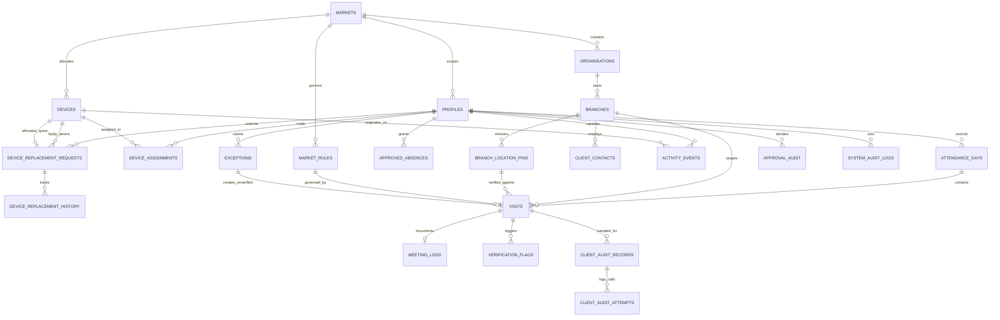

# Carbon Field Sales Tracker — Stage 2A Backend Architecture & Database Planning

**Project:** Carbon Field Sales Tracker  
**Business:** Carbon Car Care  
**Markets:** Nigeria (`Africa/Lagos`), Zambia (`Africa/Lusaka`), Malawi (`Africa/Blantyre`)  
**Specification:** PRD v1.2 (MVP Updated) & Antigravity Master Project Guide  
**Milestone:** Stage 2A — Backend Architecture & Database Planning  
**Date:** 2026-10-21  
**Status:** Architecture Specification Completed — Awaiting Stakeholder Sign-Off (Stop Gate Active)

---

## 1. Executive Summary & Architectural Scope

Stage 2A establishes the authoritative, enterprise-grade backend database architecture, security policies, and event-processing pipelines for the **Carbon Field Sales Tracker** on **Supabase (PostgreSQL 15+, PostGIS, Auth, Storage, Edge Functions, pg_cron)**.

The backend is purpose-built to support field sales operations across West, Central, and Southern Africa while strictly enforcing:
1. **Three-Role Access Boundaries:** Salesperson (mobile field capture), Country Sales Head (single-market operational review), and HQ Administrator (tri-market governance & MDM).
2. **National Market Sandboxing:** Strict logical separation between Nigeria, Zambia, and Malawi at the database Row-Level Security (RLS) layer.
3. **The Sole-Author Non-Fabrication Rule (PRD §2 & §7):** Salespeople are the sole creators of visit logs, attendance check-ins, and exception claims. Managers and HQ Administrators can review, approve, reject, or comment, but **can never originate, fabricate, or alter** salesperson field activity records.
4. **Direct Salesperson-to-HQ Device Replacement Pipeline:** Hardware replacement requests flow directly from the salesperson to HQ Admin with zero Country Sales Head approval bottleneck. Hardware issues are administrative records completely decoupled from field visit exception logs.
5. **PostGIS Geofence & Spatial Integrity:** Server-side geofencing calculations against versioned client branch pins, evaluating GPS coordinates and reported accuracy uncertainty.
6. **Strict MVP Non-Commercial Boundaries:** Zero database entities, APIs, or columns for quotations, commercial purchase orders, sales pipeline funnels, revenue analytics, task scheduling reminders, invoicing, payments, or live ERP/CRM connectors.

---

## 2. Complete Entity-Relationship Model (Mermaid ERD)



---

## 3. Comprehensive Database Schema Definitions

### 3.1 Market Scoping & Master Configuration

#### `markets`
Canonical national operational territories.
```sql
CREATE TABLE public.markets (
    code VARCHAR(2) PRIMARY KEY, -- 'NG', 'ZM', 'MW'
    name VARCHAR(64) NOT NULL,
    iana_timezone VARCHAR(64) NOT NULL, -- 'Africa/Lagos', 'Africa/Lusaka', 'Africa/Blantyre'
    currency_code VARCHAR(3) NOT NULL, -- 'NGN', 'ZMW', 'MWK' (Reference only)
    is_active BOOLEAN NOT NULL DEFAULT true,
    created_at TIMESTAMPTZ NOT NULL DEFAULT now()
);
```

#### `market_rules`
Versioned operational rules and spatial thresholds per market ([PRD §6 & §11](Carbon_Field_Sales_Tracker_PRD_v1.2_MVP_Updated.pdf)). Historical records retain immutable snapshots.
```sql
CREATE TABLE public.market_rules (
    id UUID PRIMARY KEY DEFAULT gen_random_uuid(),
    market_code VARCHAR(2) NOT NULL REFERENCES public.markets(code) ON DELETE RESTRICT,
    version_tag VARCHAR(32) NOT NULL, -- e.g. 'v1.2.04'
    geofence_radius_m NUMERIC(6, 2) NOT NULL DEFAULT 200.00,
    max_visit_gps_accuracy_m NUMERIC(6, 2) NOT NULL DEFAULT 100.00,
    max_pin_gps_accuracy_m NUMERIC(6, 2) NOT NULL DEFAULT 50.00,
    min_visit_duration_seconds INT NOT NULL DEFAULT 300, -- 5 minutes
    max_idle_gap_minutes INT NOT NULL DEFAULT 150, -- 2.5 hours
    working_hours_start TIME NOT NULL DEFAULT '08:00:00',
    working_hours_end TIME NOT NULL DEFAULT '17:00:00',
    shift_grace_minutes INT NOT NULL DEFAULT 30,
    daily_visit_target INT NOT NULL DEFAULT 6,
    effective_from TIMESTAMPTZ NOT NULL DEFAULT now(),
    effective_to TIMESTAMPTZ, -- NULL indicates current active rule version
    is_active BOOLEAN NOT NULL DEFAULT true,
    created_by UUID REFERENCES auth.users(id),
    created_at TIMESTAMPTZ NOT NULL DEFAULT now(),
    CONSTRAINT uq_market_active_rule UNIQUE NULLS NOT DISTINCT (market_code, effective_to)
);
```

### 3.2 User Accounts & Role Permissions

#### `profiles`
Application user metadata extending `auth.users` 1:1.
```sql
CREATE TYPE public.app_role AS ENUM (
    'salesperson',
    'country_sales_head',
    'hq_admin'
);

CREATE TABLE public.profiles (
    id UUID PRIMARY KEY REFERENCES auth.users(id) ON DELETE CASCADE,
    market_code VARCHAR(2) REFERENCES public.markets(code) ON DELETE RESTRICT, -- NULL only for global HQ Admin
    full_name VARCHAR(128) NOT NULL,
    email VARCHAR(255) NOT NULL UNIQUE,
    phone_number VARCHAR(32) NOT NULL,
    role public.app_role NOT NULL,
    is_active BOOLEAN NOT NULL DEFAULT true,
    last_sign_in_at TIMESTAMPTZ,
    created_at TIMESTAMPTZ NOT NULL DEFAULT now(),
    updated_at TIMESTAMPTZ NOT NULL DEFAULT now(),
    CONSTRAINT ck_sales_head_market CHECK (
        (role = 'salesperson' AND market_code IS NOT NULL) OR
        (role = 'country_sales_head' AND market_code IS NOT NULL) OR
        (role = 'hq_admin')
    )
);
```

#### `approved_absences`
Approved leave (annual, sick, compassionate) and non-visit workdays (office proposal preparation, training, internal ops). Recorded by Country Sales Head or HQ Admin.
```sql
CREATE TYPE public.absence_category AS ENUM (
    'annual_leave',
    'sick_leave',
    'compassionate_leave',
    'proposal_preparation_office',
    'training_development',
    'virtual_client_meeting',
    'internal_operations'
);

CREATE TABLE public.approved_absences (
    id UUID PRIMARY KEY DEFAULT gen_random_uuid(),
    user_id UUID NOT NULL REFERENCES public.profiles(id) ON DELETE CASCADE,
    market_code VARCHAR(2) NOT NULL REFERENCES public.markets(code),
    absence_date DATE NOT NULL,
    category public.absence_category NOT NULL,
    counts_as_attendance BOOLEAN NOT NULL DEFAULT true,
    counts_as_visit_target BOOLEAN NOT NULL DEFAULT false, -- Strict PRD rule: NEVER counts toward visit targets!
    justification TEXT NOT NULL,
    approved_by UUID NOT NULL REFERENCES public.profiles(id),
    approved_at TIMESTAMPTZ NOT NULL DEFAULT now(),
    created_at TIMESTAMPTZ NOT NULL DEFAULT now(),
    CONSTRAINT uq_user_absence_date UNIQUE (user_id, absence_date)
);
```

### 3.3 Company Mobile Devices & MDM Architecture

#### `devices`
Company-owned hardware inventory. Decouples inventory lifecycle state from security MDM status.
```sql
CREATE TYPE public.device_inventory_status AS ENUM (
    'available',
    'assigned',
    'active',
    'pending_inspection',
    'under_maintenance',
    'lost_stolen',
    'returned',
    'revoked',
    'retired'
);

CREATE TYPE public.security_authorization_status AS ENUM (
    'authorized',
    'quarantined',
    'revoked',
    'pending_activation'
);

CREATE TABLE public.devices (
    id UUID PRIMARY KEY DEFAULT gen_random_uuid(),
    asset_id VARCHAR(64) NOT NULL UNIQUE, -- e.g. 'CC-DEV-LOS-001'
    asset_tag VARCHAR(64) NOT NULL,
    make VARCHAR(64) NOT NULL, -- e.g. 'Samsung'
    model VARCHAR(64) NOT NULL, -- e.g. 'Galaxy A15 Enterprise'
    serial_number VARCHAR(128) NOT NULL UNIQUE,
    imei VARCHAR(15), -- 15-digit TAC/SNR/CD
    os_version VARCHAR(64),
    market_code VARCHAR(2) NOT NULL REFERENCES public.markets(code) ON DELETE RESTRICT,
    inventory_status public.device_inventory_status NOT NULL DEFAULT 'available',
    security_authorization public.security_authorization_status NOT NULL DEFAULT 'pending_activation',
    battery_health INT CHECK (battery_health BETWEEN 0 AND 100),
    last_sync_at TIMESTAMPTZ,
    knox_enrolled BOOLEAN NOT NULL DEFAULT true,
    supplier VARCHAR(128),
    purchase_date DATE,
    warranty_expiry_date DATE,
    notes TEXT,
    registered_by UUID NOT NULL REFERENCES public.profiles(id),
    created_at TIMESTAMPTZ NOT NULL DEFAULT now(),
    updated_at TIMESTAMPTZ NOT NULL DEFAULT now()
);
```

#### `device_assignments`
Handset chain of custody. Enforces the strict rule that a salesperson can have at most one active device at any time.
```sql
CREATE TABLE public.device_assignments (
    id UUID PRIMARY KEY DEFAULT gen_random_uuid(),
    device_id UUID NOT NULL REFERENCES public.devices(id) ON DELETE RESTRICT,
    salesperson_id UUID NOT NULL REFERENCES public.profiles(id) ON DELETE RESTRICT,
    assigned_at TIMESTAMPTZ NOT NULL DEFAULT now(),
    returned_at TIMESTAMPTZ,
    assigned_by UUID NOT NULL REFERENCES public.profiles(id),
    handover_reason TEXT,
    is_current BOOLEAN NOT NULL DEFAULT true,
    created_at TIMESTAMPTZ NOT NULL DEFAULT now()
);

-- Partial unique indexes enforcing single active device assignment
CREATE UNIQUE INDEX uq_single_active_device_per_rep 
ON public.device_assignments (salesperson_id) 
WHERE is_current = true;

CREATE UNIQUE INDEX uq_single_active_rep_per_device 
ON public.device_assignments (device_id) 
WHERE is_current = true;
```

#### `device_replacement_requests`
Direct-to-HQ device issue reporting pipeline. Salesperson submits directly to HQ Admin (`Profile → My Device → Report Device Issue`) with zero Country Sales Head approval bottleneck.
```sql
CREATE TYPE public.device_issue_category AS ENUM (
    'camera_defect',
    'gps_failure',
    'screen_damage',
    'battery_charging',
    'lost_stolen',
    'other'
);

CREATE TYPE public.replacement_request_status AS ENUM (
    'pending_review',
    'approved',
    'rejected',
    'awaiting_spare',
    'dispatched',
    'awaiting_activation',
    'completed'
);

CREATE TYPE public.old_device_disposition AS ENUM (
    'quarantined',
    'returned_to_depot',
    'revoked',
    'lost_reported'
);

CREATE TABLE public.device_replacement_requests (
    id UUID PRIMARY KEY DEFAULT gen_random_uuid(),
    salesperson_id UUID NOT NULL REFERENCES public.profiles(id) ON DELETE RESTRICT,
    market_code VARCHAR(2) NOT NULL REFERENCES public.markets(code),
    company_device_id UUID NOT NULL REFERENCES public.devices(id) ON DELETE RESTRICT,
    issue_category public.device_issue_category NOT NULL,
    issue_description TEXT NOT NULL,
    supporting_evidence_url TEXT,
    status public.replacement_request_status NOT NULL DEFAULT 'pending_review',
    replacement_device_id UUID REFERENCES public.devices(id), -- Allocated spare from depot
    approval_reason TEXT,
    rejection_reason TEXT,
    dispatch_notes TEXT,
    courier_tracking_ref VARCHAR(128),
    activation_confirmed_at TIMESTAMPTZ,
    old_device_disposition public.old_device_disposition,
    submitted_at TIMESTAMPTZ NOT NULL DEFAULT now(),
    updated_at TIMESTAMPTZ NOT NULL DEFAULT now()
);

CREATE TABLE public.device_replacement_history (
    id UUID PRIMARY KEY DEFAULT gen_random_uuid(),
    request_id UUID NOT NULL REFERENCES public.device_replacement_requests(id) ON DELETE CASCADE,
    actor_id UUID NOT NULL REFERENCES public.profiles(id),
    action VARCHAR(64) NOT NULL,
    previous_status public.replacement_request_status,
    new_status public.replacement_request_status NOT NULL,
    notes TEXT,
    created_at TIMESTAMPTZ NOT NULL DEFAULT now()
);
```

### 3.4 B2B Organizations, Branches & Versioned Location Pins

#### `organisations` & `branches`
Supports multi-branch enterprises where branches legitimately share a switchboard telephone number ([PRD §4.2](Carbon_Field_Sales_Tracker_PRD_v1.2_MVP_Updated.pdf)).
```sql
CREATE TABLE public.organisations (
    id UUID PRIMARY KEY DEFAULT gen_random_uuid(),
    name VARCHAR(128) NOT NULL,
    market_code VARCHAR(2) NOT NULL REFERENCES public.markets(code) ON DELETE RESTRICT,
    tier VARCHAR(32) DEFAULT 'standard',
    created_at TIMESTAMPTZ NOT NULL DEFAULT now()
);

CREATE TYPE public.branch_category AS ENUM (
    'fleet_operator',
    'workshop',
    'dealer',
    'distributor',
    'retail',
    'logistics'
);

CREATE TYPE public.branch_operating_status AS ENUM (
    'location_pending', -- Imported or registered without approved GPS pin
    'pending_approval',  -- Representative proposed pin, awaiting CSH review
    'active',            -- Pin verified and approved
    'rejected',          -- Proposed pin rejected by CSH
    'inactive'           -- Deprecated facility
);

CREATE TABLE public.branches (
    id UUID PRIMARY KEY DEFAULT gen_random_uuid(),
    organisation_id UUID NOT NULL REFERENCES public.organisations(id) ON DELETE RESTRICT,
    branch_name VARCHAR(128) NOT NULL,
    market_code VARCHAR(2) NOT NULL REFERENCES public.markets(code) ON DELETE RESTRICT,
    category public.branch_category NOT NULL,
    street_address TEXT NOT NULL,
    city VARCHAR(64) NOT NULL,
    switchboard_phone VARCHAR(32) NOT NULL, -- Can be shared across sibling branches!
    estimated_fleet_size INT DEFAULT 0,
    operating_status public.branch_operating_status NOT NULL DEFAULT 'location_pending',
    created_by UUID REFERENCES public.profiles(id),
    created_at TIMESTAMPTZ NOT NULL DEFAULT now(),
    updated_at TIMESTAMPTZ NOT NULL DEFAULT now()
);
```

#### `branch_location_pins`
Versioned GPS coordinates and premises photos. When coordinates are updated, a new version is created rather than silently altering historical visit audits.
```sql
CREATE TABLE public.branch_location_pins (
    id UUID PRIMARY KEY DEFAULT gen_random_uuid(),
    branch_id UUID NOT NULL REFERENCES public.branches(id) ON DELETE CASCADE,
    version_number INT NOT NULL,
    latitude NUMERIC(10, 7) NOT NULL,
    longitude NUMERIC(10, 7) NOT NULL,
    geom geometry(Point, 4326) GENERATED ALWAYS AS (
        ST_SetSRID(ST_MakePoint(longitude, latitude), 4326)
    ) STORED,
    reported_accuracy_m NUMERIC(6, 2) NOT NULL,
    premises_photo_url TEXT NOT NULL,
    status VARCHAR(32) NOT NULL DEFAULT 'pending_approval', -- 'pending_approval', 'approved', 'rejected', 'superseded'
    proposed_by UUID NOT NULL REFERENCES public.profiles(id),
    proposed_at TIMESTAMPTZ NOT NULL DEFAULT now(),
    reviewed_by UUID REFERENCES public.profiles(id),
    reviewed_at TIMESTAMPTZ,
    decision_reason TEXT,
    is_active BOOLEAN NOT NULL DEFAULT false,
    created_at TIMESTAMPTZ NOT NULL DEFAULT now(),
    CONSTRAINT uq_branch_pin_version UNIQUE (branch_id, version_number)
);

CREATE INDEX idx_branch_pins_geom ON public.branch_location_pins USING GIST (geom);
```

#### `client_contacts`
Key contacts at branches.
```sql
CREATE TABLE public.client_contacts (
    id UUID PRIMARY KEY DEFAULT gen_random_uuid(),
    branch_id UUID NOT NULL REFERENCES public.branches(id) ON DELETE CASCADE,
    organisation_id UUID NOT NULL REFERENCES public.organisations(id) ON DELETE CASCADE,
    full_name VARCHAR(128) NOT NULL,
    designation VARCHAR(64) NOT NULL,
    phone_number VARCHAR(32) NOT NULL,
    email VARCHAR(255),
    is_primary BOOLEAN NOT NULL DEFAULT false,
    created_at TIMESTAMPTZ NOT NULL DEFAULT now()
);
```

### 3.5 Field Attendance & Workdays

#### `attendance_days`
Daily salesperson shift records.
```sql
CREATE TYPE public.attendance_status AS ENUM (
    'started',
    'ended',
    'auto_closed',
    'approved_non_visit',
    'approved_leave',
    'pending_sync'
);

CREATE TABLE public.attendance_days (
    id UUID PRIMARY KEY DEFAULT gen_random_uuid(),
    user_id UUID NOT NULL REFERENCES public.profiles(id) ON DELETE CASCADE,
    device_id UUID NOT NULL REFERENCES public.devices(id) ON DELETE RESTRICT,
    market_code VARCHAR(2) NOT NULL REFERENCES public.markets(code),
    work_date DATE NOT NULL,
    started_at TIMESTAMPTZ NOT NULL DEFAULT now(),
    ended_at TIMESTAMPTZ,
    start_latitude NUMERIC(10, 7) NOT NULL,
    start_longitude NUMERIC(10, 7) NOT NULL,
    start_geom geometry(Point, 4326) GENERATED ALWAYS AS (
        ST_SetSRID(ST_MakePoint(start_longitude, start_latitude), 4326)
    ) STORED,
    start_accuracy_m NUMERIC(6, 2) NOT NULL,
    start_selfie_url TEXT NOT NULL,
    end_latitude NUMERIC(10, 7),
    end_longitude NUMERIC(10, 7),
    end_geom geometry(Point, 4326) GENERATED ALWAYS AS (
        CASE WHEN end_latitude IS NOT NULL AND end_longitude IS NOT NULL 
             THEN ST_SetSRID(ST_MakePoint(end_longitude, end_latitude), 4326) 
             ELSE NULL END
    ) STORED,
    end_accuracy_m NUMERIC(6, 2),
    status public.attendance_status NOT NULL DEFAULT 'started',
    captured_offline BOOLEAN NOT NULL DEFAULT false,
    server_received_at TIMESTAMPTZ NOT NULL DEFAULT now(),
    created_at TIMESTAMPTZ NOT NULL DEFAULT now(),
    CONSTRAINT uq_user_work_date UNIQUE (user_id, work_date)
);

CREATE INDEX idx_attendance_start_geom ON public.attendance_days USING GIST (start_geom);
```

### 3.6 Visits, Geofence Evidence & Meeting Logs

#### `visits`
Core physical visit sessions.
```sql
CREATE TYPE public.visit_kind AS ENUM (
    'normal',
    'exception_visit'
);

CREATE TYPE public.visit_verification_status AS ENUM (
    'capturing',
    'pending_sync',
    'pending_review',
    'location_verified',
    'location_unverified',
    'manager_approved_unverified',
    'pending_client',
    'disputed_pending_review',
    'confirmed_violation',
    'rejected'
);

CREATE TYPE public.location_classification AS ENUM (
    'inside_confident', -- d + a <= r
    'uncertain',        -- d <= r < d + a
    'outside',          -- d > r
    'no_fix'            -- GPS unavailable
);

CREATE TABLE public.visits (
    id UUID PRIMARY KEY DEFAULT gen_random_uuid(),
    attendance_day_id UUID NOT NULL REFERENCES public.attendance_days(id) ON DELETE CASCADE,
    user_id UUID NOT NULL REFERENCES public.profiles(id) ON DELETE CASCADE,
    device_id UUID NOT NULL REFERENCES public.devices(id) ON DELETE RESTRICT,
    branch_id UUID NOT NULL REFERENCES public.branches(id) ON DELETE RESTRICT,
    branch_pin_id UUID REFERENCES public.branch_location_pins(id) ON DELETE RESTRICT,
    rule_version_id UUID REFERENCES public.market_rules(id) ON DELETE RESTRICT,
    kind public.visit_kind NOT NULL DEFAULT 'normal',
    check_in_at TIMESTAMPTZ NOT NULL,
    check_out_at TIMESTAMPTZ,
    check_in_latitude NUMERIC(10, 7) NOT NULL,
    check_in_longitude NUMERIC(10, 7) NOT NULL,
    check_in_geom geometry(Point, 4326) GENERATED ALWAYS AS (
        ST_SetSRID(ST_MakePoint(check_in_longitude, check_in_latitude), 4326)
    ) STORED,
    check_in_accuracy_m NUMERIC(6, 2) NOT NULL,
    check_out_latitude NUMERIC(10, 7),
    check_out_longitude NUMERIC(10, 7),
    check_out_geom geometry(Point, 4326) GENERATED ALWAYS AS (
        CASE WHEN check_out_latitude IS NOT NULL AND check_out_longitude IS NOT NULL 
             THEN ST_SetSRID(ST_MakePoint(check_out_longitude, check_out_latitude), 4326) 
             ELSE NULL END
    ) STORED,
    check_out_accuracy_m NUMERIC(6, 2),
    distance_to_pin_m NUMERIC(8, 2),
    location_classification public.location_classification NOT NULL,
    premises_photo_url TEXT,
    premises_photo_hash VARCHAR(64), -- SHA-256 / perceptual dHash for duplicate detection
    verification_status public.visit_verification_status NOT NULL DEFAULT 'capturing',
    captured_offline BOOLEAN NOT NULL DEFAULT false,
    server_received_at TIMESTAMPTZ NOT NULL DEFAULT now(),
    created_at TIMESTAMPTZ NOT NULL DEFAULT now()
);

-- AT-04 Hard Block: Single open normal visit per salesperson
CREATE UNIQUE INDEX uq_single_open_visit_per_rep 
ON public.visits (user_id) 
WHERE check_out_at IS NULL AND kind = 'normal';

CREATE INDEX idx_visits_check_in_geom ON public.visits USING GIST (check_in_geom);
```

#### `meeting_logs`
Qualitative meeting documentation. Strict PRD adherence: products discussed, fleet volume, narrative outcome, and unparsed free-text next steps only.
```sql
CREATE TYPE public.visit_purpose AS ENUM (
    'routine_visit',
    'new_business',
    'technical_support',
    'relationship',
    'follow_up'
);

CREATE TABLE public.meeting_logs (
    id UUID PRIMARY KEY DEFAULT gen_random_uuid(),
    visit_id UUID NOT NULL UNIQUE REFERENCES public.visits(id) ON DELETE CASCADE,
    contact_id UUID REFERENCES public.client_contacts(id),
    purpose public.visit_purpose NOT NULL,
    products_discussed TEXT[] NOT NULL DEFAULT '{}',
    fleet_size_volume INT DEFAULT 0,
    outcome_narrative TEXT NOT NULL,
    next_step_text TEXT NOT NULL, -- Free text only! Zero task management entities.
    business_card_photo_url TEXT,
    submitted_at TIMESTAMPTZ NOT NULL DEFAULT now(),
    is_late BOOLEAN NOT NULL DEFAULT false, -- True if submitted >2h after checkout
    created_at TIMESTAMPTZ NOT NULL DEFAULT now()
);
```

### 3.7 Offline Activity Events & Idempotent Ingestion

#### `activity_events`
Immutable server-side journal for batched offline event ingestion.
```sql
CREATE TYPE public.event_processing_status AS ENUM (
    'accepted',
    'needs_review',
    'rejected'
);

CREATE TABLE public.activity_events (
    id UUID PRIMARY KEY, -- Client-generated UUID (idempotency key)
    user_id UUID NOT NULL REFERENCES public.profiles(id) ON DELETE CASCADE,
    device_id UUID NOT NULL REFERENCES public.devices(id) ON DELETE RESTRICT,
    market_code VARCHAR(2) NOT NULL REFERENCES public.markets(code),
    event_type VARCHAR(64) NOT NULL, -- 'start_day', 'check_in', 'check_out', etc.
    sequence_number BIGINT NOT NULL,
    dependency_event_id UUID,
    client_timestamp TIMESTAMPTZ NOT NULL,
    server_received_at TIMESTAMPTZ NOT NULL DEFAULT now(),
    payload JSONB NOT NULL,
    processing_status public.event_processing_status NOT NULL DEFAULT 'accepted',
    processing_notes TEXT,
    idempotency_key VARCHAR(128) NOT NULL UNIQUE,
    created_at TIMESTAMPTZ NOT NULL DEFAULT now(),
    CONSTRAINT uq_device_event_sequence UNIQUE (device_id, sequence_number)
);
```

### 3.8 Salesperson Exceptions & Manager Approval Audit

#### `exceptions`
Salesperson-authored exception claims. Enforces the strict rule that salespeople are the sole authors.
```sql
CREATE TYPE public.exception_type AS ENUM (
    'gps_failure',
    'camera_failure',
    'device_depletion',
    'missed_visit',
    'non_visit_day'
);

CREATE TYPE public.exception_review_status AS ENUM (
    'pending_review',
    'approved',
    'rejected',
    'escalated'
);

CREATE TABLE public.exceptions (
    id UUID PRIMARY KEY DEFAULT gen_random_uuid(),
    user_id UUID NOT NULL REFERENCES public.profiles(id) ON DELETE CASCADE,
    attendance_day_id UUID REFERENCES public.attendance_days(id) ON DELETE SET NULL,
    branch_id UUID REFERENCES public.branches(id) ON DELETE RESTRICT,
    exception_type public.exception_type NOT NULL,
    claimed_visit_time TIMESTAMPTZ NOT NULL,
    actual_submission_time TIMESTAMPTZ NOT NULL DEFAULT now(),
    reason TEXT NOT NULL,
    supporting_evidence_url TEXT,
    status public.exception_review_status NOT NULL DEFAULT 'pending_review',
    decided_by UUID REFERENCES public.profiles(id),
    decided_at TIMESTAMPTZ,
    decision_reason TEXT,
    resulting_visit_id UUID REFERENCES public.visits(id),
    created_at TIMESTAMPTZ NOT NULL DEFAULT now()
);
```

#### `approval_audit`
Append-only ledger documenting every manager and administrator decision.
```sql
CREATE TABLE public.approval_audit (
    id UUID PRIMARY KEY DEFAULT gen_random_uuid(),
    entity_type VARCHAR(64) NOT NULL, -- 'branch_pin', 'exception', 'client_audit', 'device_replacement'
    entity_id UUID NOT NULL,
    actor_id UUID NOT NULL REFERENCES public.profiles(id),
    action VARCHAR(64) NOT NULL, -- 'approve', 'reject', 'escalate', 'resolve_dispute'
    previous_state VARCHAR(64),
    new_state VARCHAR(64) NOT NULL,
    mandatory_reason TEXT NOT NULL,
    timestamp TIMESTAMPTZ NOT NULL DEFAULT now()
);
```

### 3.9 Risk Tripwires & Anomaly Flags

#### `verification_flags`
Automated heuristics and operational anomaly flags.
```sql
CREATE TYPE public.flag_code AS ENUM (
    'short_visit',
    'checkout_outside_geofence',
    'implausible_speed',
    'idle_gap',
    'late_meeting_log',
    'near_origin_visit',
    'duplicate_photo',
    'late_sync',
    'clock_discrepancy',
    'high_offline_share',
    'unassigned_device_used',
    'auto_closed_day'
);

CREATE TYPE public.flag_severity AS ENUM (
    'low',
    'medium',
    'high',
    'critical'
);

CREATE TYPE public.flag_status AS ENUM (
    'open',
    'under_review',
    'cleared',
    'confirmed_violation',
    'escalated'
);

CREATE TABLE public.verification_flags (
    id UUID PRIMARY KEY DEFAULT gen_random_uuid(),
    visit_id UUID REFERENCES public.visits(id) ON DELETE CASCADE,
    attendance_day_id UUID REFERENCES public.attendance_days(id) ON DELETE CASCADE,
    user_id UUID NOT NULL REFERENCES public.profiles(id) ON DELETE CASCADE,
    market_code VARCHAR(2) NOT NULL REFERENCES public.markets(code),
    flag_code public.flag_code NOT NULL,
    severity public.flag_severity NOT NULL,
    details JSONB NOT NULL DEFAULT '{}',
    status public.flag_status NOT NULL DEFAULT 'open',
    reviewed_by UUID REFERENCES public.profiles(id),
    reviewed_at TIMESTAMPTZ,
    reviewer_notes TEXT,
    created_at TIMESTAMPTZ NOT NULL DEFAULT now()
);
```

### 3.10 Client Audit Phone Calls & Dispute Escalation

#### `client_audit_records` & `client_audit_attempts`
5% random weekly audit sampling and risk-targeted telephone audits ([PRD §8.3 / AT-10](Carbon_Field_Sales_Tracker_PRD_v1.2_MVP_Updated.pdf)).
```sql
CREATE TYPE public.audit_selection_method AS ENUM (
    'random_5pct',
    'risk_targeted'
);

CREATE TYPE public.audit_call_status AS ENUM (
    'pending_call',
    'connected',
    'busy',
    'no_answer',
    'disconnected'
);

CREATE TYPE public.audit_outcome AS ENUM (
    'pending',
    'confirmed_valid',
    'disputed_denied',
    'unreachable'
);

CREATE TYPE public.dispute_resolution_status AS ENUM (
    'none',
    'under_investigation',
    'resolved_cleared',
    'resolved_violation'
);

CREATE TABLE public.client_audit_records (
    id UUID PRIMARY KEY DEFAULT gen_random_uuid(),
    visit_id UUID NOT NULL REFERENCES public.visits(id) ON DELETE CASCADE,
    market_code VARCHAR(2) NOT NULL REFERENCES public.markets(code),
    selection_method public.audit_selection_method NOT NULL,
    contact_name VARCHAR(128) NOT NULL,
    contact_phone VARCHAR(32) NOT NULL,
    meeting_confirmed BOOLEAN,
    call_status public.audit_call_status NOT NULL DEFAULT 'pending_call',
    audit_outcome public.audit_outcome NOT NULL DEFAULT 'pending',
    dispute_status public.dispute_resolution_status NOT NULL DEFAULT 'none',
    dispute_notes TEXT,
    resolved_by UUID REFERENCES public.profiles(id),
    resolved_at TIMESTAMPTZ,
    created_at TIMESTAMPTZ NOT NULL DEFAULT now()
);

CREATE TABLE public.client_audit_attempts (
    id UUID PRIMARY KEY DEFAULT gen_random_uuid(),
    audit_record_id UUID NOT NULL REFERENCES public.client_audit_records(id) ON DELETE CASCADE,
    attempt_number INT NOT NULL,
    dialed_at TIMESTAMPTZ NOT NULL DEFAULT now(),
    call_result public.audit_call_status NOT NULL,
    auditor_id UUID NOT NULL REFERENCES public.profiles(id),
    call_notes TEXT,
    created_at TIMESTAMPTZ NOT NULL DEFAULT now()
);
```

### 3.11 Administrative Ingestion, Reporting & Audit Logs

#### `import_batches` & `export_jobs`
Audit ledgers for B2B client master ingestion and audited CSV exports.
```sql
CREATE TABLE public.import_batches (
    id UUID PRIMARY KEY DEFAULT gen_random_uuid(),
    market_code VARCHAR(2) NOT NULL REFERENCES public.markets(code),
    filename VARCHAR(255) NOT NULL,
    total_rows INT NOT NULL,
    valid_rows INT NOT NULL,
    error_rows INT NOT NULL,
    location_pending_rows INT NOT NULL,
    imported_by UUID NOT NULL REFERENCES public.profiles(id),
    created_at TIMESTAMPTZ NOT NULL DEFAULT now()
);

CREATE TABLE public.export_jobs (
    id UUID PRIMARY KEY DEFAULT gen_random_uuid(),
    export_type VARCHAR(64) NOT NULL,
    market_code VARCHAR(2), -- NULL for cross-market HQ exports
    row_count INT NOT NULL,
    formula_escaped BOOLEAN NOT NULL DEFAULT true, -- CWE-1236 compliance
    downloaded_by UUID NOT NULL REFERENCES public.profiles(id),
    downloaded_at TIMESTAMPTZ NOT NULL DEFAULT now()
);

CREATE TABLE public.system_audit_logs (
    id UUID PRIMARY KEY DEFAULT gen_random_uuid(),
    timestamp TIMESTAMPTZ NOT NULL DEFAULT now(),
    actor_id UUID REFERENCES public.profiles(id),
    actor_role VARCHAR(32) NOT NULL,
    market_code VARCHAR(2),
    action VARCHAR(64) NOT NULL,
    target_entity VARCHAR(64) NOT NULL,
    target_id VARCHAR(64) NOT NULL,
    diff_summary TEXT,
    security_severity VARCHAR(32) NOT NULL DEFAULT 'info'
);
```

---

## 4. Supabase Authentication & RLS Security Policies

### 4.1 JWT Claims & Auth Custom Hook
Supabase Auth uses custom claims injected via a Postgres Auth Hook into the JWT token:
```sql
CREATE OR REPLACE FUNCTION public.custom_access_token_hook(event jsonb)
RETURNS jsonb LANGUAGE plpgsql STABLE AS $$
DECLARE
    claims jsonb;
    user_role public.app_role;
    user_market VARCHAR(2);
BEGIN
    -- Fetch role and market from public.profiles
    SELECT role, market_code INTO user_role, user_market
    FROM public.profiles
    WHERE id = (event->>'user_id')::uuid;

    claims := event->'claims';
    IF user_role IS NOT NULL THEN
        claims := jsonb_set(claims, '{app_role}', to_jsonb(user_role::text));
    END IF;
    IF user_market IS NOT NULL THEN
        claims := jsonb_set(claims, '{market_code}', to_jsonb(user_market));
    END IF;

    event := jsonb_set(event, '{claims}', claims);
    RETURN event;
END;
$$;
```

### 4.2 Security Helper Functions
All helper functions are defined as `STABLE` with a fixed, secure `search_path`:
```sql
CREATE OR REPLACE FUNCTION public.auth_uid()
RETURNS UUID LANGUAGE sql STABLE PARALLEL SAFE
SET search_path = public AS $$
    SELECT auth.uid();
$$;

CREATE OR REPLACE FUNCTION public.auth_role()
RETURNS TEXT LANGUAGE sql STABLE PARALLEL SAFE
SET search_path = public AS $$
    SELECT coalesce(
        current_setting('request.jwt.claims', true)::jsonb->>'app_role',
        'salesperson'
    );
$$;

CREATE OR REPLACE FUNCTION public.auth_market()
RETURNS TEXT LANGUAGE sql STABLE PARALLEL SAFE
SET search_path = public AS $$
    SELECT current_setting('request.jwt.claims', true)::jsonb->>'market_code';
$$;

CREATE OR REPLACE FUNCTION public.is_hq()
RETURNS BOOLEAN LANGUAGE sql STABLE PARALLEL SAFE
SET search_path = public AS $$
    SELECT public.auth_role() = 'hq_admin';
$$;
```

### 4.3 Table-by-Table RLS Permissions Matrix

| Entity | Salesperson Policy | Country Sales Head Policy | HQ Admin Policy |
|---|---|---|---|
| `profiles` | SELECT own row (`id = auth_uid()`). | SELECT reps in own market (`market_code = auth_market()`). | Full SELECT, INSERT, UPDATE across all markets. |
| `devices` | SELECT own assigned device (`id IN (SELECT device_id FROM device_assignments WHERE salesperson_id = auth_uid() AND is_current = true)`). | SELECT devices in own market (read-only). | Full SELECT, INSERT, UPDATE, allocation. |
| `device_assignments` | SELECT own custody history. | SELECT assignments in own market (read-only). | Full SELECT, INSERT, UPDATE. |
| `device_replacement_requests` | SELECT own requests (`salesperson_id = auth_uid()`). INSERT allowed for own device. | SELECT requests in own market (read-only visibility, zero approval authority!). | Full SELECT, UPDATE (approve, reject, allocate, dispatch, activate). |
| `organisations` | SELECT organisations in own market. | SELECT organisations in own market. | Full SELECT, INSERT, UPDATE across all markets. |
| `branches` | SELECT active branches + own created branches in own market. | Full SELECT and UPDATE in own market. | Full SELECT, INSERT, UPDATE across all markets. |
| `branch_location_pins` | SELECT approved pins + own proposed pins. INSERT via propose RPC. | SELECT pins in own market; UPDATE via review RPC. | Full SELECT, UPDATE across all markets. |
| `attendance_days` | SELECT own records (`user_id = auth_uid()`). INSERT via ingestion RPC only. | SELECT attendance in own market. No INSERT/UPDATE. | Full SELECT across all markets. No INSERT. |
| `visits` | SELECT own records (`user_id = auth_uid()`). INSERT via ingestion RPC only. | SELECT visits in own market. **Strictly NO INSERT/UPDATE (sole-author rule)!** | Full SELECT across all markets. **Strictly NO INSERT/UPDATE!** |
| `meeting_logs` | SELECT own meeting logs. INSERT via ingestion RPC only. | SELECT logs in own market. No INSERT/UPDATE. | Full SELECT across all markets. No INSERT/UPDATE. |
| `exceptions` | SELECT own exceptions. INSERT allowed for self (`user_id = auth_uid()`). | SELECT in own market. UPDATE status via review RPC. **Strictly NO INSERT!** | Full SELECT. UPDATE via escalation RPC. **Strictly NO INSERT!** |
| `verification_flags` | SELECT flags on own visits. | Full SELECT and review UPDATE in own market. | Full SELECT and review UPDATE across all markets. |
| `client_audit_records` | SELECT audits on own visits. | Full SELECT, INSERT, UPDATE in own market. | Full SELECT, UPDATE across all markets. |
| `market_rules` | SELECT active rule in own market. | SELECT active and historical rules in own market. | Full SELECT, INSERT (create new version) across all markets. |

---

## 5. Event-Driven Ingestion Pipeline (`ingest_activity_events`)

Field capture is ingested through an atomic, idempotent `SECURITY DEFINER` RPC function.

### Workflow:
1. **Idempotency Gate:** Client submits batch with client-generated UUIDs. If an event ID already exists in `activity_events`, return `accepted_duplicate` without re-executing.
2. **Device Custody Verification:** Asserts the submitting `auth.uid()` has an active custody assignment (`device_assignments.is_current = true`) and that the device is authorized in MDM.
3. **Monotonic Sequence Check:** Validates that `sequence_number` is strictly increasing for the given device.
4. **Spatial PostGIS Evaluation:**
   ```sql
   v_distance := ST_Distance(
       ST_SetSRID(ST_MakePoint(p_check_in_lng, p_check_in_lat), 4326)::geography,
       v_branch_pin.geom::geography
   );
   ```
   - If `v_distance + p_check_in_acc <= v_geofence_limit`: `location_classification := 'inside_confident'`
   - Else if `v_distance <= v_geofence_limit`: `location_classification := 'uncertain'`
   - Else: `location_classification := 'outside'`
5. **Read-Model Projection:** Atomically derives `visits`, `attendance_days`, `meeting_logs`, and raises automated `verification_flags` (e.g. if checkout was outside geofence or visit was <5 minutes).
6. **Separation of Timestamps:** Preserves `client_timestamp` (reported device capture time) and `server_received_at` (`now()`) to detect clock tampering anomalies.

---

## 6. Supabase Storage & Media Security Architecture

All media files are stored in private Supabase Storage buckets with strict path-based RLS:

| Bucket Name | Path Pattern | Upload Authority | Viewing Authority | Storage Policy |
|---|---|---|---|---|
| `attendance-selfies` | `{market_code}/{user_id}/{work_date}.jpg` | Salesperson (own folder) | Rep (own), CSH (own market), HQ (all) | Private; signed URLs (5-min TTL) |
| `visit-premises-photos` | `{market_code}/{branch_id}/{visit_id}.jpg` | Salesperson (own folder) | Rep (own), CSH (own market), HQ (all) | Private; signed URLs (5-min TTL) |
| `business-cards` | `{market_code}/{visit_id}/card.jpg` | Salesperson (own folder) | Rep (own), CSH (own market), HQ (all) | Private; signed URLs (5-min TTL) |
| `exception-evidence` | `{market_code}/{user_id}/{exception_id}.jpg` | Salesperson (own folder) | Rep (own), CSH (own market), HQ (all) | Private; signed URLs (5-min TTL) |
| `device-issue-photos` | `{market_code}/{user_id}/{request_id}.jpg` | Salesperson (own folder) | Rep (own), HQ Admin (direct review) | Private; signed URLs (5-min TTL) |
| `client-master-imports`| `{market_code}/{batch_id}.csv` | HQ Admin only | HQ Admin only | Private; restricted to HQ |
| `export-reports` | `{market_code}/{job_id}.csv` | System / Edge Function | Authorized CSH or HQ Admin | Private; short-lived signed URLs |

---

## 7. Scheduled Automation & pg_cron Infrastructure

1. **19:00 Provisional Digest Snapshot (`daily_reconciliation_digest`):**
   - Scheduled daily at 19:00 local time per market (`Africa/Lagos`, `Africa/Lusaka`, `Africa/Blantyre`).
   - Computes daily attendance, visit counts, verified ratios, and missing log counts.
   - Marks snapshot as **Provisional** pending the next-day 09:00 reconciliation cutoff.
2. **Abandoned Session Auto-Close (`auto_close_open_sessions`):**
   - Runs nightly at 23:59 local market time.
   - Finds normal visits where `check_out_at IS NULL` and open attendance days where `ended_at IS NULL`.
   - Closes sessions with status `auto_closed` and automatically generates an `auto_closed_day` high-severity flag for manager review.
3. **Weekly 5% Client Audit Sampling (`generate_weekly_audit_sample`):**
   - Runs Sunday at midnight local market time.
   - Uses `TABLESAMPLE SYSTEM (5)` or `ORDER BY random() LIMIT (SELECT ceil(count(*) * 0.05) ...)` on location-verified visits from the prior week.
   - Enqueues records into `client_audit_records` for Country Sales Head telephone verification.

---

## 8. Database Migration & Rollout Strategy

Migrations will be maintained in `supabase/migrations/` using chronological version numbering:

```
supabase/migrations/
├── 20261022000001_extensions_and_enums.sql
├── 20261022000002_core_markets_and_profiles.sql
├── 20261022000003_devices_and_direct_replacement.sql
├── 20261022000004_organisations_branches_and_pins.sql
├── 20261022000005_attendance_and_field_visits.sql
├── 20261022000006_offline_events_and_exceptions.sql
├── 20261022000007_audits_flags_and_governance.sql
├── 20261022000008_row_level_security_policies.sql
├── 20261022000009_rpc_ingest_and_review_functions.sql
└── 20261022000010_seed_deterministic_data.sql
```

---

## 9. Stage 2B Implementation Roadmap

Upon approval of this Stage 2A architecture, Stage 2B execution will proceed as follows:
1. **Step 2B.1 — Local Supabase Setup & Extensions:** Initialize local Supabase instance with PostGIS, pgcrypto, and extensions.
2. **Step 2B.2 — Schema Migrations Execution:** Apply migrations 00001 through 00007.
3. **Step 2B.3 — RLS Policies & Security Functions:** Apply migration 00008; execute pgTAP security test suite verifying role sandboxing and sole-author boundary.
4. **Step 2B.4 — RPC Functions & Ingestion Engine:** Apply migration 00009 (`ingest_activity_events`, approval functions).
5. **Step 2B.5 — Storage Buckets Configuration:** Configure private storage buckets and RLS policies.
6. **Step 2B.6 — Seed Data Population:** Ingest deterministic seed records matching Stage 1 frontend profiles.
7. **Step 2B.7 — Automated Backend Verification:** Run automated test suite verifying all acceptance tests AT-01 through AT-16 feasible at database level.
