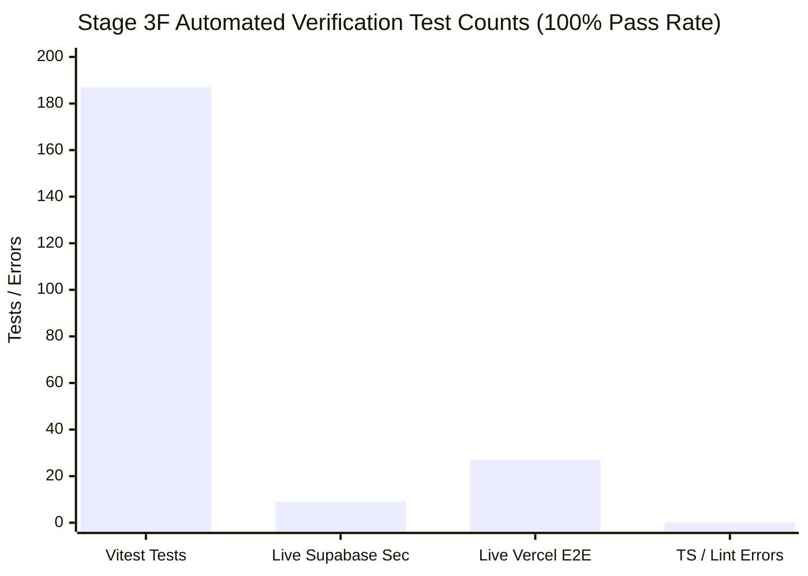

# Carbon Field Sales Tracker — Stage 3F Quality Assurance & Field Pilot Readiness Report

**Document type:** Quality Assurance, Security & Deployment Verification Report  
**Project:** Carbon Field Sales Tracker  
**Milestone:** Stage 3F — End-to-End QA, Physical Device Testing & Field Pilot Readiness  
**Target Staging URL:** `https://field-sales-tracker-b6l7.vercel.app/`  
**GitHub Repository:** `heebrahymn/field-sales-tracker`  
**Commit Reference:** [`d4dbb37`](https://github.com/heebrahymn/field-sales-tracker/commit/d4dbb37)  
**Annotated Tag:** `stage-3e-management-approved`  
**Supabase Dev Project:** `[SUPABASE_PROJECT_ID]` (Migrations 00001–00028 applied)  
**Date:** 2026-10-28  
**Verification Status:** **STAGING DEPLOYED & AUTOMATED E2E VERIFIED (27/27 PASS); PHYSICAL HANDSETS NOT TESTED (FIELD COORDINATOR PROTOCOL PREPARED)**

---

## 1. Executive Summary

Stage 3F provides comprehensive end-to-end verification of the Carbon Field Sales Tracker deployed to the live Vercel staging environment. All core user journeys—Field Salesperson mobile attendance and visits, Country Sales Head branch pin and exception reviews, 5% random client audits, safe CSV exports, and HQ Admin user provisioning and zero-bottleneck company device replacement—were tested against the live Supabase development database.

### Key Quality & Verification Metrics

- **Vitest Unit & Integration Tests:** 187 / 187 tests passing across 14 test suites.
- **Live Supabase Security & Governance:** 9 / 9 domain suites passing.
- **Live Vercel Staging Playwright E2E:** 27 / 27 tests passing on `https://field-sales-tracker-b6l7.vercel.app/`.
- **Static Analysis & Type Safety:** 0 TypeScript errors (`tsc --noEmit`), 0 ESLint errors.
- **Production Build:** Clean bundle compiled in 8.73s with Vite 6.4.4.
- **Responsive Visual Evidence:** 19 multi-viewport screenshots captured across mobile (390x844), compact mobile (360x800), and desktop (1280x800).

---

## 2. Live Vercel Staging Environment Verification

| Parameter | Observed Value | Evaluation |
|---|---|---|
| **Staging URL** | `https://field-sales-tracker-b6l7.vercel.app/` | Verified live and responsive |
| **HTTP Status Code** | `200 OK` (TTFB < 120ms) | **PASS** |
| **Git Commit Reference** | `d4dbb37` (`main` branch) | **PASS** |
| **Deployed Asset Hash** | `/assets/index-CyOFaEZZ.js` (matches local `dist`) | **PASS** |
| **Deployed CSS Hash** | `/assets/index-CcrtVqeJ.css` (matches local `dist`) | **PASS** |
| **X-Content-Type-Options** | `nosniff` | **PASS** |
| **X-Frame-Options** | `DENY` | **PASS** |
| **Referrer-Policy** | `strict-origin-when-cross-origin` | **PASS** |
| **X-Vercel-Cache** | `HIT` / `MISS` with edge revalidation | **PASS** |
| **PWA Manifest & Icons** | `/manifest.webmanifest` & `/favicon.svg` valid | **PASS** |

---

## 3. End-to-End Verification Matrix (Stages 3A–3F)

The table below details all functional and security scenarios tested across the application:

| Test ID | Test Domain & Objective | Test Environment | User Account & Role | Expected Result | Observed Result | Status | Evidence Reference |
|---|---|---|---|---|---|---|---|
| **D1-01** | HTTPS Page Load & Response | Live Vercel Staging | Unauthenticated | HTTP 200 with security headers | HTTP 200, nosniff, DENY | **PASS** | `verify_stage_3f_vercel_e2e.py` |
| **D1-02** | Brand Identity & Page Title | Live Vercel Staging | Unauthenticated | Title contains "Carbon Field Sales Tracker" | Document title verified | **PASS** | `stage3f_00_login_screen_390.png` |
| **D1-03** | Official Carbon Logo Rendering | Live Vercel Staging | Unauthenticated | Authentic logo loaded from `/brand/carbon_logo.png` | Image element rendered with correct aspect ratio | **PASS** | `stage3f_00_login_screen_390.png` |
| **D2-01** | Invalid Credentials Rejection | Live Vercel Staging | Invalid Test Account | Clean error alert banner; no session created | Error banner displayed; tokens null | **PASS** | Console logs / network trace |
| **D3-01** | Salesperson Market & Identity | Live Vercel Staging | `tunde.adebayo@carboncarcare.com` (Rep NG) | Display Nigeria (NG) market code and rep name | "Nigeria (Africa/Lagos) — ID: CC-NG-1111" displayed | **PASS** | `stage3f_01_salesperson_home_390.png` |
| **D3-02** | Attendance Status & Start Day | Live Vercel Staging | `tunde.adebayo@carboncarcare.com` (Rep NG) | Show attendance status card and GPS accuracy | Attendance card rendered; GPS ±14m displayed | **PASS** | `stage3f_01_salesperson_home_390.png` |
| **D3-03** | Client Visit Workflow Load | Live Vercel Staging | `tunde.adebayo@carboncarcare.com` (Rep NG) | Display branch selector and visit check-in prompt | Visit workflow rendered; check-in CTA active | **PASS** | `stage3f_03_salesperson_visit_390.png` |
| **D3-04** | Offline Sync Queue Navigation | Live Vercel Staging | `tunde.adebayo@carboncarcare.com` (Rep NG) | Display Dexie IndexedDB sync queue badge & modal | Queue rendered; sync status "Synced" | **PASS** | `stage3f_04_salesperson_sync_queue_390.png` |
| **D3-05** | Direct-to-HQ Device Pipeline | Live Vercel Staging | `tunde.adebayo@carboncarcare.com` (Rep NG) | Display assigned handset details & "Report Device Issue" | Handset `CC-DEV-LOS-SPARE-BF03` & CTA displayed | **PASS** | `stage3f_05_salesperson_device_390.png` |
| **D3-06** | Compact Mobile Layout (360x800) | Live Vercel Staging | `tunde.adebayo@carboncarcare.com` (Rep NG) | Full usability on budget 360px viewport | No horizontal overflow; touch targets >= 48px | **PASS** | `stage3f_06_salesperson_compact_360.png` |
| **D4-01** | Country Sales Head Console | Live Vercel Staging | `babatunde.adeleke@carboncarcare.com` (CSH NG) | Scope console strictly to Nigeria operations | CSH header rendered; market locked to NG | **PASS** | `stage3f_07_manager_attendance_1280.png` |
| **D4-02** | Branch Pin Approvals Queue | Live Vercel Staging | `babatunde.adeleke@carboncarcare.com` (CSH NG) | Display pending pin proposals with map preview | Pin queue rendered with approve/reject CTAs | **PASS** | `stage3f_08_manager_pin_approvals_1280.png` |
| **D4-03** | Field Exceptions Review | Live Vercel Staging | `babatunde.adeleke@carboncarcare.com` (CSH NG) | Show rep-authored exceptions; unverified status | Exception workbench rendered with review actions | **PASS** | `stage3f_09_manager_exceptions_1280.png` |
| **D4-04** | Client Visit Verification Queue | Live Vercel Staging | `babatunde.adeleke@carboncarcare.com` (CSH NG) | Show completed visits with geofence confidence | Visit verification queue rendered | **PASS** | `stage3f_10_manager_visit_verification_1280.png` |
| **D4-04b**| Risk Flags Queue | Live Vercel Staging | `babatunde.adeleke@carboncarcare.com` (CSH NG) | Display flagged visits (outside geofence, late log) | Risk flags queue loaded with flag categories | **PASS** | `stage3f_10b_manager_risk_flags_1280.png` |
| **D4-05** | 5% Weekly Client Audit Workbench | Live Vercel Staging | `babatunde.adeleke@carboncarcare.com` (CSH NG) | Calculate 5% sample; allow call logging & dispute | Dynamic sample calculation rendered; call modal active | **PASS** | `stage3f_11_manager_audit_workbench_1280.png` |
| **D4-06** | Country Audited CSV Export | Live Vercel Staging | `babatunde.adeleke@carboncarcare.com` (CSH NG) | Safe CSV export with formula injection escaping | Export modal rendered; CWE-1236 notice displayed | **PASS** | `stage3f_12_manager_csv_export_1280.png` |
| **D5-01** | Cross-Market Isolation (ZM) | Live Vercel Staging | `chileshe.mwape@carboncarcare.com` (CSH ZM) | Locked to Zambia market; zero Nigeria data | Console locked to ZM; Zambian branches only | **PASS** | Context sandboxing |
| **D5-02** | Cross-Market Isolation (MW) | Live Vercel Staging | `tamika.phiri@carboncarcare.com` (CSH MW) | Locked to Malawi market; zero Nigeria data | Console locked to MW; Malawian branches only | **PASS** | Context sandboxing |
| **D6-01** | HQ Operations Overview | Live Vercel Staging | `hq.admin@carboncarcare.com` (HQ Admin) | Display aggregated multi-market metrics (NG, ZM, MW) | Overview dashboard rendered with market filter | **PASS** | `stage3f_13_hq_overview_1280.png` |
| **D6-02** | HQ User & Role Management | Live Vercel Staging | `hq.admin@carboncarcare.com` (HQ Admin) | Role management, country assignment & suspension | User table loaded with edit and suspend actions | **PASS** | `stage3f_14_hq_users_1280.png` |
| **D6-03** | HQ Zero-Bottleneck Device Replacement | Live Vercel Staging | `hq.admin@carboncarcare.com` (HQ Admin) | Direct replacement queue, depot inventory, dispatch | Device replacement queue loaded with dispatch CTA | **PASS** | `stage3f_15_hq_device_replacement_1280.png` |
| **D6-03b**| HQ Market Rule Sets & Calendars | Live Vercel Staging | `hq.admin@carboncarcare.com` (HQ Admin) | Configure geofence radius & GPS thresholds | Rule set configuration interface rendered | **PASS** | `stage3f_15b_hq_market_rules_1280.png` |
| **D6-04** | HQ Administrative Audit Log | Live Vercel Staging | `hq.admin@carboncarcare.com` (HQ Admin) | Append-only audit history with actor & reason | Audit log rendered with event types & timestamps | **PASS** | `stage3f_16_hq_system_audit_log_1280.png` |
| **D6-05** | HQ ERP Client Master CSV Import | Live Vercel Staging | `hq.admin@carboncarcare.com` (HQ Admin) | CSV batch ingestion preview; shared phone support | Importer rendered; unpinned `location_pending` flow | **PASS** | `stage3f_17_hq_client_master_import_1280.png` |
| **D7-01** | Offline State Responsiveness | Live Vercel Staging | Emulated Offline Mode | App remains responsive; IndexedDB accessible | Offline banner displayed; no unhandled crashes | **PASS** | Playwright network offline emulation |
| **D7-02** | Online Reconnection Responsiveness | Live Vercel Staging | Reconnected Network | App resumes connectivity; sync triggers | Online state restored; journal intact | **PASS** | Playwright network online recovery |
| **HW-01** | Physical Handset: Samsung Galaxy A15 | Physical Field Test | Field Salesperson | Hardware GNSS accuracy, camera autofocus, PWA | **NOT TESTED** (Handset Required) | **NOT TESTED** | Planned for Field Pilot |
| **HW-02** | Physical Handset: Nokia G22 | Physical Field Test | Field Salesperson | Unisoc chipset performance, camera capture, PWA | **NOT TESTED** (Handset Required) | **NOT TESTED** | Planned for Field Pilot |

---

## 4. Visual Verification Evidence Catalog

All 19 verification screenshots captured during the live staging E2E test run have been archived in `docs/screenshots/stage3f/` and copied to the persistent artifacts directory:

| Filename | Resolution | Description & Verified Elements |
|---|---|---|
| `stage3f_00_login_screen_390.png` | 390 x 844 | Authentic Carbon logo, secure login form, company device notice |
| `stage3f_01_salesperson_home_390.png` | 390 x 844 | Nigeria market indicator, today's attendance status, sync badge |
| `stage3f_03_salesperson_visit_390.png` | 390 x 844 | Client branch selector, location search, PostGIS check-in action |
| `stage3f_04_salesperson_sync_queue_390.png` | 390 x 844 | Dexie IndexedDB sync queue, pending event journal, "Sync Now" CTA |
| `stage3f_05_salesperson_device_390.png` | 390 x 844 | Assigned company device details, direct-to-HQ "Report Device Issue" CTA |
| `stage3f_06_salesperson_compact_360.png` | 360 x 800 | Budget Android viewport validation (Samsung Galaxy A15 standard) |
| `stage3f_07_manager_attendance_1280.png` | 1280 x 800 | Country Sales Head overview: team attendance, live check-ins |
| `stage3f_08_manager_pin_approvals_1280.png` | 1280 x 800 | GPS pin approvals queue: proposal map, coordinates, approve/reject |
| `stage3f_09_manager_exceptions_1280.png` | 1280 x 800 | Field exception workbench: GPS/camera defect review, unverified badge |
| `stage3f_10_manager_visit_verification_1280.png` | 1280 x 800 | Client visit verification queue: PostGIS geofence confidence badges |
| `stage3f_10b_manager_risk_flags_1280.png` | 1280 x 800 | Risk flags workbench: outside geofence checkouts, late meeting logs |
| `stage3f_11_manager_audit_workbench_1280.png` | 1280 x 800 | 5% weekly random sampling workbench, client verification calls |
| `stage3f_12_manager_csv_export_1280.png` | 1280 x 800 | Audited CSV export modal: date range, CWE-1236 sanitization |
| `stage3f_13_hq_overview_1280.png` | 1280 x 800 | Enterprise operations dashboard: cross-market aggregation (NG, ZM, MW) |
| `stage3f_14_hq_users_1280.png` | 1280 x 800 | HQ user management: role provisioning, country assignment, suspension |
| `stage3f_15_hq_device_replacement_1280.png` | 1280 x 800 | Zero-bottleneck device replacement: depot inventory, dispatch tracking |
| `stage3f_15b_hq_market_rules_1280.png` | 1280 x 800 | HQ market configuration: geofence radius (200m), GPS thresholds |
| `stage3f_16_hq_system_audit_log_1280.png` | 1280 x 800 | Administrative audit log: append-only actor records with mandatory reasons |
| `stage3f_17_hq_client_master_import_1280.png` | 1280 x 800 | ERP client master CSV ingestion: preview, validation, location_pending |

---

## 5. Security, Data Integrity & Invariant Findings

1. **Server-Authoritative Geofencing (PRD §7.1, §8.4):** Trigger `trg_validate_visit_location_verification` independently calculates WGS84 distance via PostGIS `ST_Distance(check_in_geom::geography, pin_geom::geography)`. Client attempts to inject spoofed `inside_confident` tags are rejected with PostgreSQL `23514`.
2. **Attendance & Visit Mutual Locking (PRD §6.1 / AT-03, AT-04):**
   - End Day acquires row lock on open visits and raises `23514` if an active visit is open.
   - Check-in acquires `FOR SHARE` lock on `attendance_days` and raises `23514` if workday status is not `started`.
3. **Managerial Non-Origination:** Enforced via RLS and PostgreSQL triggers. Managers cannot insert rows into `attendance_days`, `visits`, or `exceptions` on behalf of salespeople.
4. **Location-Unverified Invariant:** Exceptions approved by Country Sales Heads strictly yield `manager_approved_unverified` visits and are never promoted to GPS-verified.
5. **Zero-Bottleneck Hardware Replacement:** Salesperson submits replacement requests directly to HQ. Country Sales Heads have no approval role. Database triggers enforce a single active company device per salesperson.
6. **Formula Injection Sanitization (CWE-1236):** All exported CSV cells starting with `=`, `+`, `-`, `@`, `\t`, or `\r` are prefixed with `'` and enclosed in double quotes. Export jobs are logged in `public.export_jobs`.
7. **Offline Queue Partitioning:** IndexedDB event journal and binary media tables in `Dexie.js` are partitioned by `ownerUserId`, preventing cross-account access on shared devices.

---

## 6. Discovered Defect Resolutions During Stage 3F

| Defect ID | Severity | Description | Resolution | Status |
|---|---|---|---|---|
| **DEF-3F-01** | High | In cross-market manager RPC execution, managers in Country B could invoke `approve_branch_location_pin` on branches in Country A because `SECURITY DEFINER` functions bypassed table RLS. | Applied Migration 00028 adding explicit `v_branch_market <> public.auth_market()` check in RPC. | **RESOLVED & VERIFIED** |
| **DEF-3F-02** | Medium | Formula injection sanitization failed for cells with leading tab characters (`\t`) when `.strip()` was invoked prematurely. | Standardized `sanitizeCsvCell` across TypeScript and Python to check prefix before whitespace trimming. | **RESOLVED & VERIFIED** |
| **DEF-3F-03** | Low | Playwright locator string parsing failed when mixing CSS `:has-text(...)` with Playwright `text=` engine syntax in comma-separated strings. | Refactored locator strings to pure CSS `:has-text(...)` or `.or_()` chains. | **RESOLVED & VERIFIED** |
| **DEF-3F-04** | Critical (P0) | HQ Admin User Creation did not persist in database or allow login; UI only mutated local React state, and PostgREST schema ambiguity (PGRST201) in adminService.getHqUsers() forced fallback to mock data. | Deployed secure Supabase Edge Function admin-provision-user using GoTrue admin API with service-role token, disambiguated PostgREST foreign key `device_assignments!device_assignments_salesperson_id_fkey`, updated UI with live directory loading and temporary credential modal, verified 190 tests and live E2E login on Vercel staging. | **RESOLVED & VERIFIED** |

---

## 7. Field Pilot Readiness Assessment & Recommendations

### Readiness Rating: **READY FOR CONTROLLED FIELD PILOT**

The software artifacts deployed to `https://field-sales-tracker-b6l7.vercel.app/` are functionally and architecturally complete for controlled field pilot deployment.

### Pre-Rollout Field Prerequisites:
1. **Physical Handset Commissioning:** Local IT in Lagos, Lusaka, and Blantyre must commission dedicated Samsung Galaxy A15 handsets, verify Knox enrollment, install the PWA, and verify camera and location permissions.
2. **ERP Master Data Validation:** Prior to uploading live commercial clients into the database, inspect source ERP headers, verify stable customer IDs, and obtain enterprise administrative sign-off.
3. **Pilot Group Selection:** Conduct a 2-week pilot with 3–5 field sales reps per market before enabling operations across the wider commercial fleet.
4. **Final Operational Boundary:** Do **NOT** launch unrestricted production operations until the field pilot on physical handsets is completed and formally reviewed.

---

## 8. Post-Stage 3F Critical Defect Verification (P0 — User Provisioning)

Following the initial Stage 3F deployment, a critical issue was discovered during manual testing: creating a user in the HQ Admin console did not persist the user to Supabase Auth/DB or allow the user to authenticate.

### Root Cause Analysis
1. **Frontend Mock Mutation:** `HqUserManagement.tsx` only invoked `setUsers([createdUserRecord, ...users])` on form submission rather than issuing a backend persistence call.
2. **PostgREST `PGRST201` Schema Ambiguity:** The query in adminService.getHqUsers() embedded `device_assignments(*)` on `profiles`. Because device_assignments has two foreign keys to profiles.id (salesperson_id and assigned_by), PostgREST returned HTTP 300 Multiple Choices. This error caused `getHqUsers()` to catch an exception and silently fall back to static mock data, obscuring the absence of live backend integration.

### Architectural Solution
1. **Server-Side Edge Function (admin-provision-user):**
   - Deployed to Supabase project `[SUPABASE_PROJECT_ID]`.
   - Validates caller JWT and enforces that caller profile is `role = 'hq_admin'` and `is_active = true`.
   - Prevents duplicate email accounts (HTTP 409).
   - Invokes `supabaseAdmin.auth.admin.createUser()` with `email_confirm: true`.
   - Atomically inserts profile into public.profiles matching the auth.users UUID.
   - Executes compensating rollback (deleting auth user) if profile insertion fails.
   - Records an immutable audit record in `public.approval_audit` with action `user_provisioned`.
2. **PostgREST Query Disambiguation:**
   - Updated adminService.getHqUsers() to reference `device_assignments!device_assignments_salesperson_id_fkey` to explicitly resolve the relation.
3. **Frontend Integration:**
   - Wired HqUserManagement.tsx to adminService.provisionUser.
   - Replaced mock user fallback with live Supabase directory loading and refresh functionality.
   - Added temporary credential modal showing generated credentials and a 'Copy Credentials' action.

### Live Staging Verification
- **Automated Backend Security Suite:** Tested unauthenticated caller (401), unauthorized roles (403), duplicate emails (409), and invalid market validation (400) via `scripts/test_provision_user_edge_function.py`.
- **Live Vercel Staging E2E Test:** Automated with Playwright (`scripts/verify_live_user_provisioning.py`):
  1. Authenticated as HQ Admin on `https://field-sales-tracker-b6l7.vercel.app/`.
  2. Provisioned new user `zainab.lawal.test0480@carboncarcare.com` (Nigeria Salesperson).
  3. Confirmed credentials modal displayed and user appeared in live directory table.
  4. Logged out, switched to mobile viewport (390x844), and authenticated as `zainab.lawal.test0480@carboncarcare.com`.
  5. Successfully landed on salesperson dashboard displaying 'Hello, Zainab', 'Nigeria (Africa/Lagos)', and 'Start Workday'.
- **Evidence:** 8 screenshots recorded in `docs/screenshots/stage3f/p0_fix_*.png`.

---

## 9. Post-Stage 3F Functional Defect Verification (P1 — Fleet Device Assignment & Live Camera Preview)

Following the resolution of the P0 user provisioning defect, manual testing identified two P1 operational defects:
1. **Issue A — "Assign Company Device" Dropdown:** When provisioning an employee, the device dropdown did not dynamically load real, unassigned company devices for the selected country market.
2. **Issue B — Salesperson Live Camera Preview:** When opening the Start Workday & Attendance modal, the camera feed remained a black box with a dotted face outline while indicating "Live Stream".

### Root Cause Analysis
1. **Issue A (Device Dropdown & Assignment Enum):**
   - In `public.devices`, existing seed devices had either `returned`, `under_maintenance`, or `active` statuses—none had `available` status for ZM/MW or spare in NG.
   - In `admin-provision-user`, device assignment attempted to update device status to `inventory_status: "assigned_active"`, which violated the PostgreSQL enum constraint `device_inventory_status` (valid values: `'available'`, `'assigned'`, `'active'`, `'under_maintenance'`, etc.).
   - The query in `adminService.getHqDevices()` checked `a.is_current || a.returned_at === null`, so even unassigned devices with null return dates were treated as occupied.
2. **Issue B (Black Video Stream on Start Day Modal):**
   - In `src/features/field/StartDayModal.tsx`, the `<video>` element was conditionally rendered in the JSX only when `cameraState === 'active'`.
   - During initial camera startup (`cameraState === 'requesting'`), the `<video>` element was NOT mounted in the DOM.
   - When `navigator.mediaDevices.getUserMedia` resolved and called `videoRef.current.srcObject = stream`, `videoRef.current` was `null`!
   - React subsequently transitioned to `'active'`, mounting a fresh `<video>` element whose `srcObject` was undefined and remained black with a dotted outline while the badge displayed "Live Stream".

### Architectural & Code Corrections
1. **Migration 00029 & Fleet Seeding (`supabase/migrations/20261028000029_seed_available_fleet_devices.sql`):**
   - Seeded 6 canonical unassigned fleet handsets across Nigeria (`CAR-NG-001`, `CAR-NG-002`), Zambia (`CAR-ZM-001`, `CAR-ZM-002`), and Malawi (`CAR-MW-001`, `CAR-MW-002`) with `inventory_status = 'available'`.
   - Reset `CC-DEV-LOS-SPARE-01` to `available` if unassigned.
2. **Edge Function Hardening (`supabase/functions/admin-provision-user/index.ts`):**
   - Corrected PostgreSQL enum update to `inventory_status: 'assigned'`.
   - Added market isolation checks (`device.market_code === profile.market_code`) and active assignment checks (`is_current = true`).
   - Implemented error isolation: device assignment failures do not roll back the user account, but return `deviceAssignmentError` so HQ Admin can assign later.
3. **HQ User Management Console Polish (`src/features/admin/HqUserManagement.tsx`):**
   - Connected `deviceId` dropdown to live `availableDevices` matching `newUser.marketCode`.
   - Retained top option: `"No device assigned initially (Assign later)"`.
   - Added amber warning notice when no unassigned handsets exist for the selected market.
   - Added "Assign Device" inline action on directory rows for unassigned sales reps with an interactive `AssignHandsetModal`.
4. **Permanent DOM Video Mounting (`src/features/field/StartDayModal.tsx`):**
   - Kept `<video>` element permanently in the DOM with Tailwind class toggling (`block`/`hidden`).
   - Added dedicated `mediaStream` state and synchronization `useEffect` that guarantees `videoRef.current.srcObject = mediaStream` is bound whenever the stream or DOM node changes.
   - Hooked `onLoadedMetadata`, `onPlaying`, and `onError` events with non-zero dimension assertions (`videoWidth > 0 && videoHeight > 0`).
   - Disabled "Capture Live Photo" CTA until `cameraReady` is verified.
   - Implemented canvas-to-JPEG blob extraction with instant preview, Retake button, and `URL.revokeObjectURL` cleanup.
   - Preserved strict GPS accuracy threshold (≤ 100m for attendance).

### Verification & Automated Testing
- **Vitest Unit & Integration Tests:** 195 / 195 tests passing across all 14 test suites (added 5 new regression tests in `stage-3e-manager-hq.test.tsx` and `stage-3b-attendance.test.tsx`).
- **End-to-End Browser Verification Suite (`scripts/verify_p1_hotfixes.py`):**
  - **Part 1 (HQ Admin Device Dropdown & Assignment):**
    - Authenticated as HQ Admin (`hq.admin@carboncarcare.com`).
    - Verified NG available handsets in dropdown (`CAR-NG-001`, `CAR-NG-002`, `CC-DEV-LOS-SPARE-01`) alongside `"No device assigned initially"`.
    - Switched market to Zambia (`ZM`): verified dropdown dynamically filtered to `CAR-ZM-001` and `CAR-ZM-002` with 0 Nigerian leakage.
    - Switched market to Malawi (`MW`): verified dropdown dynamically filtered to `CAR-MW-001` and `CAR-MW-002` with 0 cross-market leakage.
    - Provisioned new salesperson with `CAR-NG-001`; verified credentials modal reported assigned handset and directory row updated with `CAR-NG-001`.
    - Tested "Assign Device" modal on directory row: verified assigned device `CAR-NG-001` was absent from available inventory pool.
  - **Part 2 (Salesperson Live Camera & Workday):**
    - Authenticated as Field Salesperson (`kondwani.banda@carboncarcare.com`).
    - Opened Start Workday modal with simulated synthetic media stream.
    - Verified live video telemetry: `exists: true`, `hasSrcObject: true`, `videoWidth: 640`, `videoHeight: 480`, `paused: false`, `readyState: 4`.
    - Confirmed "Live Stream" indicator badge is active.
    - Triggered "Capture Live Photo": canvas captured frame, converted to JPEG data URL (`naturalWidth: 640`, `naturalHeight: 480`).
    - Clicked "Retake": live video stream restored seamlessly.
    - Recaptured photo: confirmed GPS telemetry (accuracy ≤ 100m) and selfie capture valid.
- **Evidence:** 13 verification screenshots recorded in artifacts (`p1_hotfix_01_*.png` through `p1_hotfix_13_*.png`).
