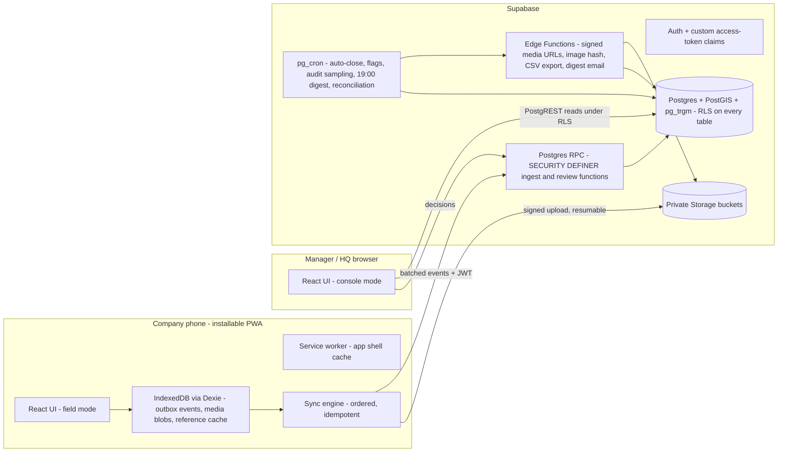
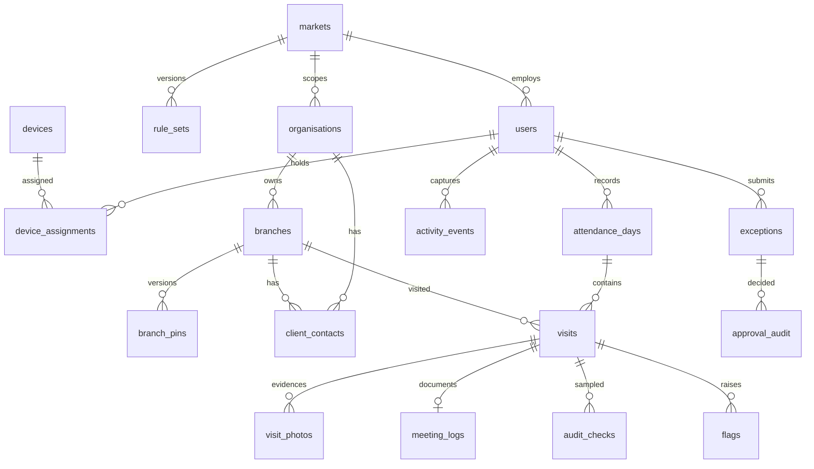
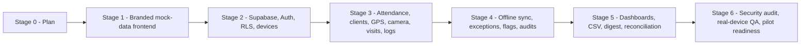

# Carbon Field Sales Tracker — Stage 0 Implementation Plan

**Status:** Approved by Stakeholder (2026-10-16). **Stage 1A Authorized.**  
**Sources reviewed:** `AGENTS.md`, `docs/ANTIGRAVITY_MASTER_PROMPT.md`, `docs/Carbon_Field_Sales_Tracker_PRD_v1.2_MVP_Updated.pdf` (22 pages), `public/brand/carbon_logo.png`.

> [!NOTE]
> I read the PRD by extracting its text with `pypdf`. Some table rows came out reflowed. The clearest case is §6.1 "Hard blocks": I rebuilt the "Active workday" and "One open visit" rows from text that ended up at the bottom of that page. Images and diagrams in the PDF were not reviewed.

---

## 0. Review findings

### 0.1 Confirmed MVP scope (PRD v1.2 + guide)

- **In scope:** attendance (Start/End Day with GPS and a live selfie), organisations/branches with pin approval, check-in/out against a geofence with a live premises photo, meeting logs, salesperson-created exceptions (GPS, camera, device failure, missed visit, abandoned-visit correction), non-visit day requests, offline queue and sync, flags, 5% random and risk-based client audits, manager dashboards (daily/weekly/quarterly), safe CSV export, 19:00 provisional digest plus reconciliation, HQ admin (users, devices, calendars, rule thresholds, imports).
- **Excluded (no screens, tables, APIs or KPIs):** quotations, follow-up tasks/reminders, orders, opportunities/pipeline, conversion/revenue analytics, invoicing/payments, fuel/allowances, continuous tracking, route optimisation, face matching, client portals, live ERP/CRM.

### 0.2 Discrepancies to resolve

| # | Discrepancy | Proposed resolution |
|---|---|---|
| D1 | The guide §5 says the logo is at `public/brand/carbon-car-care-logo.png`. `AGENTS.md` and the actual file use `public/brand/carbon_logo.png`. | Use `carbon_logo.png`, the file that exists. Update the guide's path after you approve. |
| D2 | The PRD names "Lovable + Supabase" as the platform. You've specified React/TS/Vite/Tailwind/shadcn built with Antigravity. | Same underlying stack, so no functional impact. Record as a decision. |
| D3 | PRD Appendix A stage numbers (1–6) and rollout phases (0–4) don't match the guide's Stages 0–6. | The guide's stage gates govern the build. Appendix A content is mapped into them (§5). |
| D4 | The guide's non-visit activity list says "office **quotation** preparation". The PRD says "**proposal** preparation". | Use the PRD wording, "Proposal preparation (office)", so there's no hint of quotation features. |
| D5 | PRD Phase 0 asks for an early real-device technical proof (GPS, camera, storage, restart). The guide puts GPS/camera in Stage 3 and offline in Stage 4. | Optionally run a throwaway real-device spike alongside Stage 2 (§5.2). Needs your approval. |
| D6 | The PRD doesn't say who records **approved leave**. | Proposal: Sales Head/HQ record leave in `work_schedules`. Leave isn't salesperson visit evidence, so this doesn't break the "manager never creates logs" rule. Needs confirmation. |

### 0.3 Logo review

- 4318×742 px PNG with a **transparent background** (RGBA). Horizontal wordmark at about 5.8:1: a green/blue/yellow swoosh mark, then "CARBON" in blue and "CAR CARE" in green.
- It works well on white or light surfaces. There is **no reversed (white) version**, so the logo must not be placed on blue or dark backgrounds.
- There is **no square mark** for the favicon, PWA icons or a collapsed sidebar. See question Q2.

---

## 1. Technical architecture

### 1.1 System overview



### 1.2 Architectural principles

1. **Field capture is written as events.** The salesperson client never writes directly to `visits` or `attendance_days`. Every capture (start day, check-in, check-out, meeting log, exception, registration) is an immutable `activity_events` row with a client UUID. It goes through one `SECURITY DEFINER` RPC (`ingest_activity_events`), which:
   - checks `auth.uid()`, role = salesperson, market, device and session;
   - enforces idempotency (event UUID is the primary key);
   - checks event order and dependencies, then reruns geofence and accuracy checks with PostGIS;
   - derives read-model rows (`visits`, `attendance_days`, `flags`) in the same transaction;
   - returns `Accepted / Needs Review / Rejected + reason` for each event (PRD §9.3).
2. **Permissions live in the database, not just the UI.** RLS plus RPC role checks mean a Sales Head or HQ Admin can't insert visits, exceptions or events, even with direct API calls (AT-12, AT-14).
3. **Manager decisions are append-only.** A review RPC writes `approval_audit` (actor, before/after state, reason, evidence) and updates status columns. It never changes the original evidence.
4. **Status dimensions stay separate.** Location evidence, meeting-log state, client audit, exception approval and attendance are independent columns. They are never merged into a single "valid" flag.
5. **Rules are versioned.** Thresholds live in a versioned `rule_sets` table per market. Events and visits store the `rule_version` and `pin_version` that applied, so later edits never reclassify past visits.
6. **Business rules are pure, testable functions.** `src/domain/` (geofence classification, status transitions, flag catalogue, market-time helpers) is plain TypeScript with no React or IO. It is unit-tested with Vitest. Its server-side counterparts are covered by SQL tests.
7. **The UI depends on repository interfaces, not on Supabase.** In Stage 1 a mock adapter sits behind the interfaces. In Stage 2+ a Supabase adapter replaces it without rewriting screens, which keeps the mock-data UI usable after Stage 1.
8. **Honest about evidence.** The UI and docs never call GPS or photos proof of a meeting, never call device time trusted, and never call the offline queue tamper-proof or guaranteed.

### 1.3 Frontend stack (versions checked at install)

| Concern | Choice |
|---|---|
| Build / language | Vite + React + TypeScript (strict) |
| Styling / UI | Tailwind CSS (version: see Q1) + shadcn/ui (Radix) + Lucide |
| Routing | React Router (library/data mode) with role-based route guards |
| Server state | TanStack Query (Stage 1: mock repositories with simulated latency and errors) |
| Tables / forms | TanStack Table; React Hook Form + Zod (the Zod schemas double as data contracts) |
| Charts / time | Recharts; date-fns + `@date-fns/tz` for market time zones |
| Maps | Leaflet / react-leaflet on manager views only (tile provider: see risk R11) |
| Font | Manrope variable, **self-hosted** via `@fontsource-variable/manrope` so it works offline |
| Offline (Stage 4) | `vite-plugin-pwa` (Workbox), Dexie, `navigator.storage.persist()` |
| Testing | Vitest + React Testing Library; Playwright (E2E and screenshots); pgTAP/SQL tests for RLS (Stage 2) |

### 1.4 Navigation map

```mermaid
flowchart TB
  L["/login"] --> SP["Salesperson /field"]
  L --> SH["Sales Head /review"]
  L --> HQ["HQ Admin /admin"]
  SP --> SP1["Home"] & SP2["Start Day / End Day"] & SP3["Clients: search, nearby, branch detail"] & SP4["Add Branch / Propose Pin"] & SP5["Active Visit: check-in, check-out"] & SP6["Meeting Log"] & SP7["My Exceptions + New Exception"] & SP8["Non-Visit Day Request"] & SP9["Sync Queue"] & SP10["Profile, Device, Privacy Notice"]
  SH --> SH1["Dashboard: daily, weekly, quarterly"] & SH2["Team + Salesperson Day View: timeline and map"] & SH3["Branch and Pin Approvals"] & SH4["Exception Workbench"] & SH5["Flags Queue"] & SH6["Audit Call Workbench"] & SH7["Clients: org and branch history"] & SH8["Attendance"] & SH9["CSV Exports"]
  HQ --> HQ1["Cross-market Overview"] & HQ2["Users and Roles"] & HQ3["Devices"] & HQ4["Markets: calendars and rule thresholds"] & HQ5["Client Master Import"] & HQ6["Exports and Download Log"] & HQ7["Escalations"] & HQ8["System Audit Log"]
```



- **Salesperson (mobile):** bottom nav with Home · Clients · **Visit** (centre action) · Exceptions · More (Sync, Profile). A status strip is always visible: attendance · sync · GPS.
- **Sales Head / HQ (desktop):** collapsible sidebar, top bar with a market filter (fixed to the user's own market for Sales Heads), queue counts as badges. HQ can open every Sales Head view across all markets.

---

## 2. Project folder structure

```text
carbonSalesTracker/
├─ AGENTS.md
├─ docs/
│  ├─ ANTIGRAVITY_MASTER_PROMPT.md · Carbon_Field_Sales_Tracker_PRD_v1.2_MVP_Updated.pdf
│  ├─ decisions/            # ADRs + approved-decision log (stage approvals recorded here)
│  └─ qa/                   # AT-01–AT-16 traceability matrix, device/browser matrix
├─ public/
│  ├─ brand/carbon_logo.png # official — never modified
│  ├─ icons/                # derived PWA/favicons (only after Q2 approval)
│  └─ demo/                 # demonstration media, all files prefixed demo-
├─ src/
│  ├─ main.tsx · App.tsx
│  ├─ app/                  # providers, router, route guards, layouts (FieldLayout, ConsoleLayout)
│  ├─ components/
│  │  ├─ ui/                # shadcn primitives (owned source)
│  │  ├─ brand/             # BrandLogo
│  │  ├─ layout/            # AppShell, Sidebar, MobileBottomNav, TopBar, PageHeader
│  │  ├─ data-display/      # KpiCard, DataTable, StatusBadge, Timeline, AuditHistory, EvidenceViewer, MapPanel
│  │  ├─ feedback/          # EmptyState, ErrorState, Skeletons, ConfirmDialog, ApprovalDialog, DemoDataBanner
│  │  ├─ forms/             # FormField, ChipMultiSelect, SearchInput, DateRangeFilter
│  │  └─ field/             # ActionTile, SyncStatusIndicator, GpsStatusPill, GeofenceIndicator, CaptureStep
│  ├─ features/
│  │  ├─ auth/
│  │  ├─ field/             # salesperson: home, attendance, clients, visits, meeting-log, exceptions, non-visit, sync, profile
│  │  ├─ review/            # sales head: dashboard, team, day-view, approvals, exceptions, flags, audits, clients, attendance, exports
│  │  └─ admin/             # HQ: overview, users, devices, markets, imports, exports, escalations, audit-log
│  ├─ domain/               # pure TS rules: status/, geo/, flags/, time/, permissions/ (UI hints only)
│  ├─ data/
│  │  ├─ contracts/         # TS types + Zod schemas (API contract)
│  │  ├─ repositories/      # interfaces consumed by hooks
│  │  ├─ mock/              # deterministic seed + in-memory adapters (Stage 1)
│  │  └─ supabase/          # Stage 2+
│  ├─ hooks/                # TanStack Query hooks
│  ├─ offline/              # Stage 4: Dexie schema, outbox, media queue, sync engine
│  ├─ lib/                  # cn(), formatters, (Stage 5) csv-escape
│  ├─ styles/index.css      # Tailwind + design tokens
│  └─ test/                 # setup, render helpers
├─ supabase/                # Stage 2+: migrations/, functions/, tests/ (pgTAP), seed.sql
├─ e2e/                     # Playwright specs + screenshot baselines
└─ index.html · vite.config.ts · tsconfig*.json · components.json · eslint.config.js · package.json
```

---

## 3. Frontend design system and UI strategy

### 3.1 Colour tokens (with WCAG contrast checks)

| Token | Value | Use | Contrast note |
|---|---|---|---|
| `brand-blue` | `#21409A` | Primary actions, active nav, links, headings accent | ≈9.3:1 on white ✅ text and buttons |
| `brand-green` | `#1B9A4A` | Brand accents, verified icons, large fills | ≈3.6:1 on white: **fails AA for small text** |
| `brand-green-700` | ~`#157A3A` (derived) | Green text and white-on-green buttons | ≥4.5:1 ✅ |
| `brand-yellow` | `#E8CF2F` | Highlights, focus accents, chips with dark text | ≈1.4:1 on white: **never text on white**. Dark text on yellow ✅ |
| `ink` / `ink-muted` | `#0F172A` / `#475569` | Body / secondary text | ✅ (no lighter grey for text on mobile) |
| `surface` / `surface-2` / `border` | `#FFFFFF` / `#F8FAFC` / `#E2E8F0` | Backgrounds, cards, dividers | — |

Each brand colour gets a generated 50–950 scale, exposed as CSS variables and mapped onto the shadcn theme variables (`--primary`, `--ring`, etc.).

**Semantic status palette.** Every status badge pairs **icon + text label + colour**, so nothing is shown by colour alone (PRD §9.3):

| Meaning | Examples | Treatment |
|---|---|---|
| Verified / positive | Location Verified, Client Confirmed, Approved | Green-700 on green-50, check icon |
| Approved but unverified | Manager Approved — Location Unverified | Amber-800 on amber-50, shield-alert icon (kept distinct from brand yellow) |
| Pending / provisional | Pending Sync, Pending Review, Pending Client, Provisional | Slate/blue on slate-50, clock icon |
| In progress | Syncing, Under Review, Started | Blue on blue-50, animated spinner (respects reduced motion) |
| Attention | Disputed — Pending Review, Escalated, Late log | Orange-800 on orange-50, alert icon |
| Negative | Rejected, Confirmed Violation, Failed | Red-700 on red-50, x icon |
| Offline | Offline, Captured Offline | Dark slate on slate-100, cloud-off icon |

### 3.2 Typography, spacing, motion

- **Manrope** (variable). Tabular numbers for KPIs, times and distances. Scale: 12 / 14 / 16 / 18 / 20 / 24 / 30 / 36. Mobile body text is at least 16 px (also stops iOS input zoom).
- 4 px spacing grid. Corner radius 8 px on controls and 12 px on cards. Shadows are restrained (one or two elevation levels). Cards use borders rather than heavy shadows.
- **Touch targets:** at least 48 px. Primary field actions are 56–64 px tall and full-width in the thumb zone.
- **Motion:** 150–200 ms transitions on hover, focus, drawers and toasts. No decorative animation. `prefers-reduced-motion` is respected.
- Light theme only for MVP: best for outdoor readability and a smaller scope. Tokens are structured so a dark theme can be added later.

### 3.3 Logo usage rules

- Use the official `carbon_logo.png` only. Keep its proportions, never recolour, crop-to-redraw or add effects, and place it only on white or light-neutral surfaces.
- Placement: login (large, centred), expanded desktop sidebar (~32 px tall), mobile top bar (~24–28 px tall), and the loading/splash screen.
- Collapsed sidebar, favicon and PWA icons are **blocked on Q2**.
- One `BrandLogo` component holds the sizes, alt text ("Carbon Car Care") and minimum clear space.

### 3.4 UI strategy by role

| Role | Mode | Principles |
|---|---|---|
| Salesperson | **Field mode** (mobile-first) | One primary action per screen. Large action tiles (Start Day, Visit Client, Add Branch, My Exceptions, End Day, Sync Now). Step-by-step capture flows with progress and clear retry/exception paths. Persistent attendance/sync/GPS strip. Readable in sunlight. No follow-up, quote or order menus. |
| Sales Head | **Review console** (desktop-first, responsive) | Starts from "what needs my decision". KPI strip with clear **Provisional** labels. Queues with SLA countdowns. Side-drawer detail with an evidence viewer and audit history. Decision dialogs require a reason. No "create visit/exception" actions anywhere. |
| HQ Admin | **Admin console** | Cross-market overview and market switcher. Configuration screens show version history (rule thresholds, calendars). Import wizard with validation preview. Download log for exports. |

### 3.5 Component inventory

App shell · responsive sidebar · mobile bottom nav · top bar · BrandLogo · PageHeader · KpiCard (value, delta, provisional marker) · DataTable (sorting, filtering, pagination, column visibility, row drawer) · FilterBar (market, user, period) · StatusBadge (typed per status domain) · ConfirmDialog · ApprovalDialog (approve / reject / comment / escalate, reason required) · Skeletons · EmptyState · ErrorState · SyncStatusIndicator · GpsStatusPill (accuracy in m) · GeofenceIndicator (inside / uncertain / outside) · EvidenceViewer (photo lightbox plus metadata: time, accuracy, pin version, capture marker) · AuditHistory timeline · Day Timeline · MapPanel · ActionTile · CaptureStep · FormField family · DemoDataBanner · OfflineBanner · PrivacyNotice.

---

## 4. Supabase database architecture (designed now, implemented in Stage 2)

### 4.1 Entities

**PRD canonical tables (§8.1–8.2):** `markets`, `users` (1:1 with `auth.users`), `devices`, `work_schedules`, `attendance_days`, `organisations`, `branches`, `client_contacts`, `client_changes`, `visits`, `visit_photos`, `meeting_logs`, `activity_events`, `exceptions`, `flags`, `audit_checks`, `approval_audit`, `import_batches`, `export_jobs`.

**Proposed supporting tables (each tied to a PRD requirement):**

| Table | Justification |
|---|---|
| `rule_sets` | PRD §6: thresholds are configurable per market and *logged when changed*; visits record the rule version. |
| `branch_pins` | PRD §4.3/§8.3: versioned pins with original and revised coordinates; visits must reference the pin version they were checked against. |
| `device_assignments` | PRD §2.3: issue/return dates and approved replacement history. |
| `report_snapshots` | AT-16 and §7.2: keep the 19:00 provisional digest and each reconciliation without overwriting earlier snapshots. |

**Not created:** `quotations`, `orders`, `reported_orders`, `opportunities`, `follow_up_tasks`, and any pipeline or revenue columns. The PRD lists `markets.currency` as reference data only; no table stores monetary values.



### 4.2 Status enums (PRD §8.4, kept as separate columns)

| Domain | Values |
|---|---|
| Visit evidence | `capturing, pending_sync, pending_review, location_verified, location_unverified, pending_client, rejected` |
| Location classification | `inside_confident (d+a≤r), uncertain (d≤r<d+a), outside, no_fix` |
| Exception-approved marker | `manager_approved_location_unverified` (from an approved exception; **never** promoted to verified) |
| Meeting log | `missing, submitted_on_time, submitted_late, needs_clarification` |
| Client audit | `not_audited, confirmed, disputed, resolved_valid, confirmed_false, inconclusive` (+ `sample_type: random / risk`) |
| Exception | `draft, submitted, under_review, approved, rejected, escalated`. Kind: `gps_failure, camera_failure, device_failure_missed_visit, missed_visit, abandoned_visit_correction, non_visit_day` |
| Flag | Status `open, under_review, cleared, confirmed_violation, escalated`. Severity `low…critical`. ~23 rule codes from PRD §6.3–6.4 |
| Attendance | `scheduled, started, ended, auto_closed, approved_non_visit, approved_leave, absent, pending_sync` |
| Organisation / branch | `location_pending, pending_approval, active, rejected, inactive` |
| Device | `pending_approval, active, revoked, returned` |

**Visit counting rule (PRD §3.2 / §7.1):** a visit counts as `location_verified` only when the branch is eligible, a server-accepted location reading is `inside_confident`, a premises photo is validated, check-in/out timestamps exist, and the meeting log is submitted. Disputes and audits never silently overwrite location status.

### 4.3 Security model

- **Identity:** a custom access-token Auth Hook adds `app_role` and `market_id` claims. Helper functions `auth_role()`, `auth_market()`, `is_hq()` are `STABLE` and have a fixed `search_path`.
- **RLS summary:**

| Table group | Salesperson | Sales Head | HQ Admin |
|---|---|---|---|
| Own evidence (events, visits, attendance, meeting logs, exceptions) | SELECT own; writes **only** via ingest RPC | SELECT own market; **no INSERT**; status changes via review RPC | SELECT all; **no INSERT** |
| Clients (orgs, branches, contacts, pins) | SELECT active + own-proposed in own market; propose via RPC | SELECT market; approve/adjust via RPC | All markets |
| Flags / audits / approval_audit | SELECT own (incl. reply to disputes) | Market; decide via RPC | All |
| Config (rule_sets, schedules, devices, users) | SELECT own | Market read; approve device reassignment | Manage via RPC |

- **Append-only:** `UPDATE`/`DELETE` revoked, plus blocking triggers, on `activity_events`, `approval_audit`, `visit_photos`, submitted `meeting_logs`, `client_changes` and `report_snapshots`. Corrections are new linked records.
- **Storage:** private buckets `selfies`, `premises`, `business-cards`, `imports`, `exports`. Object path is `{market_id}/{user_id}/{event_id}.jpg`, with storage RLS on the path segments. Uploads use resumable signed URLs from an Edge Function with MIME/size checks. Managers view photos through short-TTL signed URLs. Stamped copies are kept separately for exports.
- **Secrets:** the service-role key is used only inside Edge Functions and never reaches the browser.

### 4.4 Integrity, indexes, extensions

- `activity_events.id` = client UUID (primary key, so idempotent). `(device_id, sequence)` is unique. `server_received_at` defaults to `now()`.
- **AT-04 at the database level:** a partial unique index on `visits(user_id) WHERE closed_at IS NULL AND kind = 'normal'`.
- `attendance_days (user_id, local_day)` is unique.
- PostGIS `geography(Point)` on `branch_pins`, with a GiST index for Nearby (2 km) and the duplicate-within-100 m check. `pg_trgm` on organisation/branch names for search and similar-name warnings. Phone numbers are normalised and indexed but **never unique**.
- Composite indexes on `(market_id, local_day)` and `(market_id, status, due_at)` for the dashboards and queues.
- Extensions: `postgis`, `pg_trgm`, `pg_cron`, `pg_net`.

### 4.5 Scheduled jobs (per market time zone)

| Job | Default schedule |
|---|---|
| Interval flags (no visits by 12:00, idle gap, late start/early finish) | Through the working day |
| 19:00 provisional digest → `report_snapshots` + email | 19:00 local |
| Day auto-close + `day_not_closed` flag | Configured day boundary (default 23:59 local) |
| Reconciliation after late sync (new snapshot, earlier ones kept) | Next morning |
| Weekly 5% random audit sample + risk-based picks; HQ weekly export | Monday |

---

## 5. Development roadmap



### 5.1 Milestones and acceptance-test mapping

| Stage | Milestones | AT coverage | Gate |
|---|---|---|---|
| **1** | 1a Foundation (tokens, shell, BrandLogo, mock layer) · 1b Salesperson flows · 1c Sales Head console · 1d HQ admin · 1e Responsive QA and walkthrough | UI states for AT-02/03/04/09/10/11/12/13. AT-15 scope check (no commercial UI) | **Design approval** |
| **2** | Supabase dev project, migrations, enums, Auth Hook, RLS, storage policies, device inventory, seed data, pgTAP suite. Swap in the Supabase repository adapter for reads | AT-12, AT-14 (direct API), AT-15 (schema) | Security review |
| **3** | Live GPS (`enableHighAccuracy`, freshness, accuracy), `getUserMedia` capture with compression, Start/End Day, branch registration with duplicate warnings, pin proposals, check-in/out, meeting logs, online ingest RPC | AT-01, 02, 03, 04, 09, 10, 11 | Workflow tests |
| **4** | Dexie outbox and media queue, ordered idempotent sync, server time anchors, salesperson exceptions incl. retrospective, flags engine, audit sampling and dispute flow | AT-05, 06, 07, 08, 12, 13 | Resilience tests |
| **5** | Daily/weekly/quarterly dashboards on real data, safe CSV export (formula escaping, schema version), 19:00 digest, reconciliation snapshots, map tiles provider | AT-16, AT-15 (KPIs) | Reconciled data review |
| **6** | Security audit, real-phone GPS/camera/offline matrix, backup/restore rehearsal, monitoring, privacy notice, pilot runbook | AT-01–16 on real devices | Stakeholder sign-off |

A git commit or tag is made at every approved gate, e.g. `stage-1-approved`. Each approval is recorded in `docs/decisions/`.

### 5.2 Optional real-device spike (D5)

The PRD treats offline reliability as the main delivery risk and asks for early real-phone proof. I propose a small, separate throwaway test page during Stage 2 that exercises GPS accuracy, camera capture, IndexedDB persistence across app kill/restart, and `storage.persist()` on the actual company handsets. It wouldn't touch production code and needs your explicit approval.

---

## 6. Technical risks and mitigations

| # | Risk | Impact | Mitigation |
|---|---|---|---|
| R1 | **iOS/Safari PWA limits** (no Background Sync API, storage eviction, camera permission behaviour in standalone mode) | High | Confirm the handset matrix early (Android/Chrome preferred). Sync on open, on reconnect and via manual Sync Now. Call `storage.persist()`. Run the real-device spike. |
| R2 | Browser storage cleared or device lost, so unsynced events are gone | High | Be explicit that this can happen. Flag device resets. The server shows last sync and last reported pending count. Retrospective salesperson exception path (AT-08). Never fabricate records. |
| R3 | Poor GPS in urban canyons or indoors | High | `d + a ≤ r` classification, an "uncertain" state with guided retry, exception route, pilot calibration of the 100 m / 50 m / 200 m thresholds. |
| R4 | GPS spoofing / mock-location apps | High | A PWA can't detect them reliably. Recommend MDM on company phones (block developer options). Impossible-travel, duplicate-photo and near-origin flags. 5% audits. Honest labels. |
| R5 | Device clock manipulation | Med | Server time anchors, sequence checks, clock-anomaly flag. Device time is treated as a claim (AT-07). |
| R6 | Large photos on weak networks | Med | Client-side resize/compress (~1280 px, ~200–400 KB). Separate media queue with resumable uploads. Event stays `Pending media` until the photo validates. |
| R7 | **RLS misconfiguration** or role bypass | Critical | pgTAP tests per role and table. Direct REST tests for AT-12/14. `SECURITY DEFINER` functions with a fixed `search_path`. No service key in the client. Security review gate. |
| R8 | Manager creates evidence through the API | Critical | RLS denies INSERT. RPC checks `auth.uid()` = creator and role = salesperson. Automated tests. |
| R9 | Commercial scope creep | Med | AT-15 automated test that scans routes, nav labels and schema for quote/order/pipeline/follow-up-task terms. Rejected at review. |
| R10 | Edge Function CPU limits for perceptual image hashing | Med | Compute a dHash on a small server-side thumbnail asynchronously. Duplicate-photo flags are informational only. |
| R11 | OSM public tile usage policy | Med | Dev uses OSM with attribution. Production uses an approved provider (decided in Stage 5). Field flows never depend on tiles. |
| R12 | Data residency and cross-border transfer (Nigeria, Zambia, Malawi data-protection laws) | High | Legal review before go-live. Choose the Supabase region knowingly. Retention durations approved before Stage 6. The software doesn't claim compliance. |
| R13 | Time zone and day-boundary bugs across three markets | Med | Store `timestamptz` in UTC plus the market IANA zone. Compute the `local_day` server-side. Unit tests for boundary cases. |
| R14 | Flag false positives overwhelm Sales Heads | Med | Per-market thresholds, severity triage, pilot calibration weeks 1–2 with no penalties. |
| R15 | Mock UI mistaken for working features | Med | Persistent "Demonstration data" banner. GPS/camera steps labelled "Simulated". Demo sign-in clearly labelled. |
| R16 | No square logo mark for icons | Low | Q2. |

---

## 7. Stage 1 frontend implementation plan

### 7.1 Scope rules for Stage 1

- ✅ Branded responsive UI for all three roles. Typed mock repositories with **deterministic seeded data** (3 markets, ~18 salespeople, ~40 organisations, ~90 branches including shared-phone examples, ~2 weeks of visits plus quarterly aggregates, every exception/flag/audit status).
- ✅ Working navigation, filters, tables, forms with Zod validation, and demo approval/reject/escalate dialogs. These change in-memory mock state only and reset on reload.
- ✅ Real, unit-tested pure domain logic: geofence classification, status labels and allowed transitions, flag catalogue, market-time helpers.
- ❌ No production auth, Supabase client, GPS, `getUserMedia`, service worker/offline sync or deployment.
- **Demo sign-in:** "Continue as Salesperson / Sales Head / HQ Admin", clearly labelled "Demo access — production authentication arrives in Stage 2".
- **Simulated capture:** GPS steps offer a scenario picker (good fix inside, uncertain boundary, outside, no fix, permission denied) to show every UX state. Camera steps show a "Simulated capture" frame.

### 7.2 Build sequence

| Step | Work |
|---|---|
| 1 | Scaffold Vite React-TS. The folder already contains files, so scaffold in a temp folder and move files in, or configure manually (non-interactive). Set strict TS, the `@/` alias, ESLint and Prettier. |
| 2 | Tailwind (per Q1) + shadcn init. Tokens in `styles/index.css`. Self-hosted Manrope. |
| 3 | Core components (§3.5) plus `BrandLogo`, `StatusBadge`, `DemoDataBanner`. |
| 4 | `data/contracts` (Zod), repository interfaces, mock seed and adapters, TanStack Query hooks. |
| 5 | Router, role guards, `FieldLayout` (mobile) and `ConsoleLayout` (desktop). |
| 6 | **Salesperson screens (~14):** Login, Home, Start Day (selfie + GPS simulation), Clients search/Nearby, Branch detail (contacts, pins, history), Add Branch (duplicate and shared-phone warning), Active Visit (check-in → in-progress timer → check-out incl. outside-geofence flag notice), Meeting Log (PRD categories, free-text next step), My Exceptions + New Exception (by kind, incl. retrospective claimed time vs submission time), Non-Visit Day request, End Day, Sync Queue (all six sync states), Profile/Device/Privacy notice. |
| 7 | **Sales Head screens (~12):** Daily / Weekly / Quarterly dashboards (Recharts, provisional labels), Team list, Salesperson Day View (timeline + Leaflet map + evidence), Branch & Pin Approvals (map, photo, duplicate warnings, SLA), Exception Workbench + detail with ApprovalDialog, Flags queue, Audit Call Workbench (random vs risk labels, outcomes → dispute), Clients/org history, Attendance, Exports. |
| 8 | **HQ Admin screens (~9):** Cross-market overview, Users & roles, Devices (assign, revoke, approval state), Markets: calendars + versioned rule thresholds, Client master import wizard (upload → validation preview with row errors → confirm, mock), Exports + download log, Escalations, System audit log. |
| 9 | Polish: skeleton, empty, error and offline-banner states on every data view; keyboard and focus checks; reduced motion. |
| 10 | Verification (§7.3), walkthrough artifact, git commit, **stop for approval.** |

### 7.3 Stage 1 verification

- `tsc --noEmit`, ESLint, `vite build` (to validate the build only, no deployment).
- Vitest: domain rules (geofence edge cases `d+a=r`, `d=r`, accuracy overlap), status mapping, key components (StatusBadge shows text and icon, ApprovalDialog requires a reason, Sales Head views have no create-exception action).
- **AT-15 scope test:** asserts no routes or nav labels contain quotation/order/pipeline/opportunity/follow-up-task terms.
- Browser walkthrough with screenshots and recordings at **390×844 (mobile)** and **1440×900 (desktop)** for all three roles, plus a tablet check at 768 px.
- Report what was implemented, which files changed, test results and limitations, then **stop for design approval.**

---

## 8. Approved Stakeholder Decisions (Stage 0 Sign-Off)

**Recorded 2026-10-16 in `docs/decisions/0001-stage-0-approval.md`:**

1. **Q1 — Tailwind version:** **Tailwind CSS v4** approved, with compatible shadcn/ui components, React, TypeScript, and Vite.
2. **Q2 — Official Logo & Icons:** Option C approved. Full official logo at `public/brand/carbon_logo.png` preserved in original colors, transparency, and proportions. Defer dedicated square icons until an official square asset is approved; temporary neutral development favicon used in Stage 1 without representing it as production PWA icon.
3. **Q3 — Demo Evidence Media:** Approved. AI-generated fictional premises photos clearly watermarked/labelled "DEMO". Neutral silhouette illustrations for selfies (no fictional faces). Stored strictly in `public/demo/`.
4. **Q4 — Wording, Permissions & Governance:**
   - Logo path canonical reference: `public/brand/carbon_logo.png`.
   - Activity label: "Proposal preparation (office)".
   - Approved leave recorded by Country Sales Heads and HQ Admins in work schedules.
   - **Strict permission rule confirmed:** Managers and HQ Admins must never create salesperson visit logs, missed-visit logs, or GPS/device-failure exception logs. Only the authenticated salesperson can create and submit them. Enforced at RLS and server RPC level.
5. **Brand Colours & Contrast:** Blue `#21409A`, Green `#1B9A4A`, Yellow `#E8CF2F`. Darker semantic variants (e.g. Green-700 `#157A3A`) used for text/buttons to guarantee WCAG AA ≥4.5:1.
6. **Early Real-Device Testing:** Isolated technical feasibility spike approved for real company handsets, kept separate from production codebase.
7. **Scope Authorization:** Stage 0 confirmed. **Stage 1A — Frontend Design System and Application Shell only** authorized.
